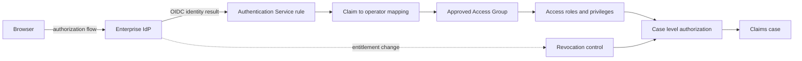

# OpenID Connect Architecture for Enterprise SSO

**PFA-137 | Lead System Architect technical study | Laboratory verification pending**

## Failure scenario: a successful login is not authorization

A bank consolidates several claims applications behind an enterprise OpenID Connect identity provider. An assessor transfers from the Northern claims unit to the Southern unit. The IdP updates the employee's groups, but a long-running Pega requestor still resolves the old Access Group. A second employee is automatically provisioned from a group claim into an administrator role because the mapping has no allowlist. Both users authenticate successfully. The production defect is authorization after identity changes, not a failure of OIDC token signature validation.

The architecture must distinguish identity proof, Pega operator provisioning, application access, record-level permission and revocation. Treat the identity provider as an authentication authority, not as an unrestricted source of Pega privileges.

## Logical architecture

This is a proposed design, not a captured environment. The IdP, application, operator directory and case data owner need separate accountability and incident contacts.

## Pega rule objects and configuration decisions

1. Create an OIDC Authentication Service rule for the deployed Pega release. Configure issuer discovery metadata, redirect URI, client registration and expected provider identity. Verify audience and issuer handling using the supported platform controls rather than writing an unreviewed token parser in an Activity.
2. Map an immutable identity subject to Operator ID. Email and display name are mutable and should not be the only identity join keys. Define a deterministic rejection or holding state for unknown subjects and duplicate matches.
3. Where dynamic operator provisioning is enabled, give newly provisioned operators a minimal approved Access Group. External group claims must pass an explicit allowlist and role-mapping decision before higher privileges are granted.
4. Use Rule-Access-Role-Obj, privileges and application-specific case access checks to enforce permissions. A user who can open a portal must not automatically be able to read every case returned by a Report Definition, Data Page or service.
5. Define tenant, region and customer-record constraints at server-side read and write boundaries. Direct URLs, DX or REST calls and background work must not bypass the same authorization policy.
6. Keep client credentials in the supported environment secret-management mechanism. Test signing-key and client-secret rotation without placing secrets in rules, traces, exception messages or Git.
7. Agree session expiry, reauthentication and entitlement-change handling with the identity team. A new token is not proof that all existing Pega requestors immediately re-evaluate their permissions.

## Step-by-step implementation

**1. Inventory entry points.** Separate interactive browser OIDC sign-in from API OAuth and unattended service identities. Record which client and Access Group each route uses. Do not share a human administrator identity with scheduled integrations.

**2. Agree the claims contract.** Define issuer, audience, subject, tenant, approved group identifiers, MFA assurance and clock-skew expectations. Assign a business owner to each authorization attribute. Treat optional claims as absent until validated.

**3. Configure staging federation.** Register a dedicated test client and the exact redirect URI, configure the Authentication Service, and verify metadata refresh and provider key rotation with the identity team.

**4. Implement the mapping.** Map approved identities to the least-privilege operator context. Reject ambiguous mappings. Keep administrative privilege grants separate from ordinary user onboarding.

**5. Enforce record-level access.** Test the same claim through portal navigation, direct case identifiers, report results, Data Pages and service endpoints. Confirm that a region filter is not merely a UI condition.

**6. Test entitlement change during an active session.** Transfer a test user to another business unit while a case tab remains open. Attempt to submit the old assignment. Server-side checks must reject unauthorized writes even when the browser still shows an old view.

**7. Promote with recovery controls.** Preserve an audited break-glass procedure that does not depend on the failing provider, and prepare rollback of mapping configuration without reopening access to restricted records.

## Tradeoffs

Just-in-time provisioning reduces identity administration but can create privileged operators too readily if mapping rules are permissive. Pre-provisioning improves approval controls but may delay access after a legitimate transfer.

Short sessions reduce the window for stale entitlements but increase authentication traffic and user disruption. Evaluate the sensitivity of claims and the actual session behaviour of the installed Pega release.

IdP-managed groups centralize identity administration; Pega Access Groups encode application-specific business responsibilities. A translation layer avoids coupling every application release to changes in enterprise directory naming.

## Production failure mechanics

A token with an unexpected audience or issuer must fail authentication before operator mapping. A valid identity with an unapproved group must not gain elevated Pega privileges. A disabled operator must not be able to complete an old assignment from a still-open browser tab.

During incident diagnosis, correlate provider sign-in ID, Pega requestor, operator, case identifier, effective Access Group, ruleset version and the final authorization result. Never store raw ID tokens, client secrets or confidential claim payloads in diagnostic logs.

## Reproducible verification matrix

These are proposed tests. **No test has been executed or measured for this article.**

| Controlled scenario | Action | Expected result | Status |
| --- | --- | --- | --- |
| Approved assessor | Authenticate with approved region claim | Only authorized region cases accessible | Pending |
| Unknown employee | Present valid identity without approved mapping | No privileged operator provisioned | Pending |
| Wrong token audience | Use token issued for another client | Authentication rejected | Pending |
| Business-unit transfer | Change group while old tab remains open | Old case submission denied | Pending |
| Provider signing-key rotation | Rotate test IdP key | New sign-in succeeds using supported metadata flow | Pending |
| Provider unavailable | Block IdP in staging | Controlled login failure and audited recovery | Pending |
| Direct case access | Request another region's case identifier | Server-side access denied | Pending |

For each row retain the platform version, ruleset stack, test operator, UTC run time, correlation ID, observed response and redacted evidence. A passed login test is not a passed authorization test.

## Operating model and rollback

Monitor failed sign-ins, newly provisioned operators, privileged grants, denied case reads and denied case updates as separate signals. Alert on unusual administrative grants. Define the access-revocation SLA and assign responsibility for stale-session handling. Rollback of an Authentication Service change must not restore unauthorized access.

Before release, document whether open cases can continue safely under the previous application ruleset, whether any operator mapping migration is reversible and which security events must be retained for audit. The proposed controls require validation against the supported platform version.

## Verified primary reference

[Pega Academy: Authentication](https://academy.pega.com/topic/authentication/v6/in/99681) describes supported authentication mechanisms, including OpenID Connect. Configuration options and their exact behaviour are version-dependent.

**Verification: design-backed-lab-pending. No screenshots, production evidence or test results are claimed.**
