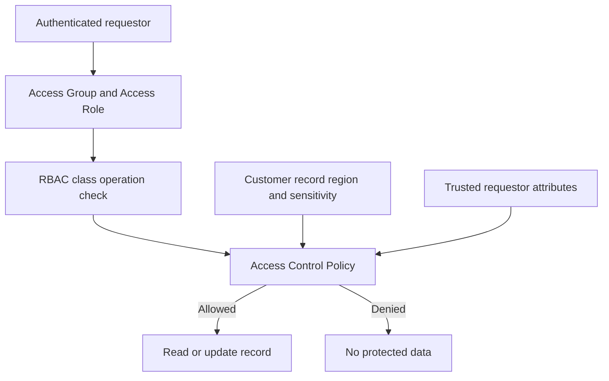

# Attribute-based authorization for customer records

> Architecture study for Lead System Architects. The failure narrative is a hypothetical engineering scenario; no production incident or test result is claimed.

## Enterprise failure scenario

A national bank deploys one CustomerService application to branches and a central fraud team. Branch operators hold the same Access Role but must only see customers assigned to their region. An analyst can search for an out-of-region case ID and open it through a deep link because the screen filters by region while the underlying data class allows Read. A search-result filter is not a security boundary. The requirement is record-level authorization across UI, DX API, reports, data pages and background processing.

## Architecture decision and Pega rule design

Use RBAC as the coarse capability boundary and attribute-based access control for record and property decisions. Define a clear policy subject, object and operation. The subject contains a verified RegionId, business unit and clearance context from the authenticated requestor; the object stores a normalized OwningRegion and SensitivityCode. Configure Rule-Access-Policy and Rule-Access-PolicyCondition on the appropriate Work-, Data- or Assign- classes, using supported Access When conditions. Read, Discover, Update, Delete and PropertyRead are separate decisions. Never equate permission to discover a case with permission to read its contents. Preserve default-deny behavior for absent attributes.

## Technical flow

## Implementation sequence

1. Create an authorization matrix by persona, object class and operation. Include cross-region handoff, fraud override, delegated supervisor, API service account and revoked employee. Record why each exception exists.

2. Normalize region and clearance on protected instances. Treat blank values as restricted until migrated. Avoid deriving ownership from display labels that may change with locale.

3. Map identity-provider claims into trusted operator or requestor-scoped attributes at authentication. Revalidate the mapping after role changes; do not accept the region from a browser request parameter.

4. Configure Access Roles to Objects and applicable Access Deny rules for baseline permissions. Add named Access Control Policy Conditions with explicit comparisons against trusted requestor properties.

5. Apply Read and Discover intentionally to work classes and underlying customer data classes. Add PropertyRead for sensitive identifiers. Review inherited policies and how multiple conditions combine.

6. Review all access paths: case opening, report definitions, list data pages, export, search, attachment references, Service REST and queue processors. Do not rely on a hidden button as authorization.

7. Implement a controlled exceptional-access case with approval, expiry and audit logging rather than a permanent 'all regions' boolean on operators.

8. Test after switching Access Groups and after removing an operator's region entitlement, using fresh requestors and active sessions.

## How the design fails in production

An incorrectly scoped requestor data page can retain stale entitlements after a supervisor changes teams. An authorization rule that invokes a slow external service per row can make a report unusable; cache only trusted claims within an explicitly bounded freshness contract. A permissive Discover policy can reveal customer existence even when Read is denied. Inherited policies may combine more restrictively than expected. Emergency overrides that are not time-limited become silent permanent access. Inspect rule resolution and class hierarchy rather than deleting policies until a test passes.

## Genuine tradeoffs

RBAC is easier to audit for stable job functions, while ABAC scales better when thousands of records have changing ownership. ABAC also increases test combinations and can make poorly chosen queries expensive. Denormalized ownership improves policy evaluation but creates synchronization obligations. Select fail-closed authorization even if a transient identity-provider outage delays work.

## Reproducible verification matrix

| Test setup and stimulus | Expected observable result |
| --- | --- |
| Same role, different region | Only owning-region records readable |
| Deep link to out-of-region case | Denied regardless of UI navigation |
| Search or Report Definition | No unauthorized fields or row details returned |
| Blank or malformed subject attribute | Fail closed and log policy outcome |
| Supervisor approved exception expires | Access disappears after expiry |
| Service account executes background step | Only explicitly scoped records processed |

Run each test against a named application version with independent requestors where relevant. Record configuration, input fixtures, observed response, persisted state and log correlation identifiers. The expected results above are acceptance criteria, not claims of execution. A failed row blocks a production recommendation until investigated.

## Release and evidence boundaries

Pega's authorization documentation distinguishes RBAC and ABAC and describes Access Control Policy rule types. Exact configuration labels, encryption support and policy evaluation details must be checked against the target Pega release. Verify behavior with a version-matched Pega environment and approved sample data. Include security review, recovery runbook, and rollback assessment in the change record. Do not infer correctness from a successful UI response alone.

## Primary references

- [Pega product guidance](https://academy.pega.com/topic/authorization-models/v7)
