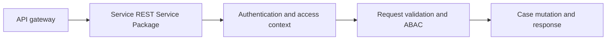

# Securing Pega Service Packages Independently of the Portal

**PFA-140** | Technical design study for Pega Senior and Lead System Architects | Laboratory verification pending

## Architecture problem

A service account posts a case creation payload through Service REST. The developer assumes portal access-role rules protect the endpoint, but the API uses a different authentication and runtime context. An attacker may bypass every browser visibility check simply by making a direct service call.

## System design

This diagram records a proposed boundary, not a fabricated Pega runtime screenshot. The interfaces and exact rule forms must be verified in a permitted sandbox.

## Feature inventory and design responsibilities

| Pega rule or component | Review requirement |
|---|---|
| Service Package | Primary configuration and ownership boundary |
| Service REST rule | Explicit input/output and identity contract |
| Authentication service/OAuth 2.0 | Apply platform-version-specific controls |
| Access Group and ARO | Test failure handling and observability |
| Access Control Policy and privileges | Validate runtime access and support procedure |

## Implementation approach

1. Inventory every exposed Service REST endpoint with data classification and permitted client identities.

2. Configure supported authentication at the Service Package and endpoint boundary, not just in the portal.

3. Assign a purpose-limited service account or effective runtime context and explicit class permissions.

4. Validate client-supplied case ID, tenant ID, class and requested action; do not permit arbitrary parameter-driven privilege escalation.

5. Use record-level access policies for sensitive rows and data in addition to class-level roles.

6. Constrain request size, timeout, rate and schema, preferably with an API gateway providing additional controls.

7. Test the endpoint directly without a portal session and record denial responses without leaking sensitive records.

## Design alternatives

| Option | Architectural trade-off |
|---|---|
| Reuse admin access for service integration | Easy setup, unacceptable blast radius |
| Dedicated service access and ABAC | Strong enforceable separation |
| Gateway authentication alone | Useful layer, insufficient if Pega authorizes too broadly |

Choose the option that satisfies the business consistency contract and operational constraints. Avoid proving only the success path while deferring security, stale state and recovery behaviour.

## Failure modes and troubleshooting

One access group may have far more permissions than intended. Direct API clients can set fields hidden in UI. Search endpoints can reveal tenant records through aggregate counts. Background callbacks may invoke rules after a caller's rights have changed. Server-side authorization must be the final boundary.

Capture a sanitized case ID or operation identifier, relevant runtime node, application/ruleset version and timestamps. Correlate the origin and outcome across Pega and partner systems instead of relying on a single status message.

## Verification experiments

| Scenario | Evidence required |
|---|---|
| Experiment 1 | Call endpoint without token and verify denial. |
| Experiment 2 | Call with valid token for tenant A but case ID from tenant B. |
| Experiment 3 | Attempt to set a protected internal approval property. |
| Experiment 4 | Rate-limit burst requests and inspect case creation integrity. |

These are experiments to perform in a Pega lab. The article does not claim that any test has passed. A lab-verified version should include actual configuration screenshots, observed results and target Pega version.

## Production acceptance

Before deployment, the implementation needs documented data ownership, access context, expected peak volume, case compatibility, timeouts and retry boundaries, monitoring, escalation owner and a tested operational repair path. If the design changes a data model or class structure, verify legacy case paths and queued work.

## Pega technical source

- [Primary Pega reference](https://academy.pega.com/topic/authentication/v6)

Independent original technical analysis. Pega version-specific features and terminology must be confirmed against the target release; the scenario is fictional.
