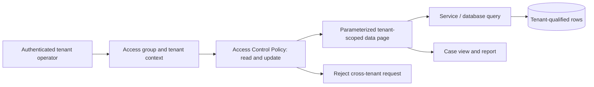

# Multi-tenant data partitioning and cache isolation

**Scope:** Pega enterprise architecture and LSA implementation guidance. Platform capabilities and menu paths may vary by release; verify in the target version.

## The failure to design against

A claims administrator serves two insurers on the same Pega deployment. Tenant A's operator opens an account view after a colleague from tenant B has loaded the same reference data. A node-scoped D_CustomerSummary data page is keyed only by CustomerID, and the two insurers both use customer 00418. The second operator receives the first insurer's contact details. Both users have valid access groups, and the API call succeeds, so an ordinary availability monitor reports a healthy system. This is a confidentiality breach caused by an incomplete cache key, not a login failure.

The architecture must distinguish tenant identity, user identity and business object identity. Treat the tenant boundary as an invariant at every read and write path. A page name, a portal label or a UI filter is not a security boundary. Tenant ownership must be persisted or deterministically derived from an authoritative system and enforced again when an object is loaded outside the UI.

## Rule and data design

Define a canonical TenantID field on the relevant data and work classes, with explicit ownership rules for each case type. Where physical segregation is required by contract, use separate databases or deployments rather than assuming an Access Control Policy can provide a legal or operational isolation guarantee. A shared database is viable only when tenant-qualified access is consistently enforced in reporting, search, APIs and background execution.

Model D_CustomerSummary as a parameterized data page with TenantID and CustomerID parameters. Choose requestor or thread scope when data depends on the active operator; node scope is only defensible for immutable, tenant-independent data or a carefully proven tenant-keyed cache with equivalent authorization. Cache expiry does not correct a wrong key. On every lookup, compare the requested TenantID with the trusted operator context, not a value supplied by the browser. Use the tenant key in the connector request, data page load activity or report definition and in any upstream cache key.

Implement Access Control Policy rules and conditions for Read, Update and Discover on Work-, Data- and Assign- classes as applicable. A tenant mismatch should deny even if the user knows a case ID. Configure Access of Role to Object and privileges for action-level authority, then ABAC for record-level ownership. PropertyRead masking can reduce exposure of selected fields, but must not be used as the primary tenant boundary. Check in policy changes before expecting runtime enforcement, and verify the exact platform version's policy semantics.

## Implementation sequence

1. Catalogue case, data, assignment, report and search entry points. Include scheduled jobs, queue processors, service REST endpoints and administrative screens, not just portal views.
2. Introduce an immutable or controlled TenantID in persistence. Backfill existing instances using reconciled source-system mappings; quarantine ambiguous ownership instead of guessing.
3. Build a tenant context resolver from authenticated identity or a trusted server-side mapping. Do not allow client JSON or URL parameters to override that value.
4. Parameterize data pages and connectors, then review the generated or hand-written query predicates. A requestor-level cache may still leak between contexts if a single requestor can switch tenants without explicit invalidation.
5. Add Access Control Policy rules to each relevant class. Test open-by-ID, report list, search results, delegated access and API actions independently.
6. Ensure queue items carry the intended tenant identity as validated work metadata. Re-establish authorization in the worker rather than borrowing the original interactive clipboard state.
7. Instrument denial counts and tenant-context mismatches with opaque identifiers. Never emit customer names, account numbers or unmasked payloads into diagnostic events.
8. Roll out behind a controlled migration gate. Compare tenant-qualified row counts and sampled ownership in a non-production copy before enabling new filters.

## Design tradeoffs

Shared-schema isolation is less expensive to operate but creates more paths to audit. Separate schema or deployment isolation reduces cross-tenant query risk while increasing upgrades, routing and operational overhead. Node-scoped data pages can reduce repeated lookup cost but are dangerous when cache keys omit tenant context. Requestor scope costs more memory and backend traffic; it is often the safer initial choice for user-specific material. A single shared integration credential is operationally convenient but requires strong downstream tenant scoping and audit correlation.

## Production failure mechanics

The first incident is commonly detected as a wrong-row result rather than a permission error. Reproduce the same CustomerID under two tenants and inspect the actual data page parameter values, cache scope, resolved policy and connector query. A later failure can occur when a worker retries an item under a service operator with broad access. The worker must still assert tenant ownership. Avoid clearing every node cache as the first response: contain access, capture sanitized evidence, fix the key or policy and invalidate only affected instances.

## Reproducible verification matrix

| Test | Setup and execution | Required observation |
| --- | --- | --- |
| Identical business keys | Seed CustomerID 00418 for tenants A and B; alternate requestors | Each operator sees only its own row |
| Direct case URL | Open a tenant B case as tenant A | Read denied, no sensitive fields in response |
| Report and search | Run list/search as both roles | No foreign-tenant results or counts |
| Background retry | Retry an item with the wrong tenant marker | Worker rejects or quarantines without mutation |
| Cache refresh | Load A, then B, then expire or invalidate page | No stale cross-tenant value at any step |
| Access change | Revoke tenant A mapping during a session | Next protected operation is reauthorized |

This is a design-backed test plan, not a claim that a specific Pega release or environment passed it. Record the platform version, data page scope, resolved rules and sanitized evidence when running the matrix.

## Primary references

- [Pega: Creating an access control policy](https://docs.pega.com/bundle/platform-23/page/platform/security/create-access-control-policy.html)
- [Pega: Removing a data page](https://docs.pega.com/bundle/platform-88/page/platform/data-integration/removing-data-page.html)

## Architecture flow

## Evidence required before production approval

Attach a reviewed design decision, the actual Pega version and deployment topology, rule references with their Applies To classes, test inputs and observed outcomes. Record open risks, remediation owners and rollback criteria. The verification matrix above is a proposed protocol, not fabricated execution evidence.
