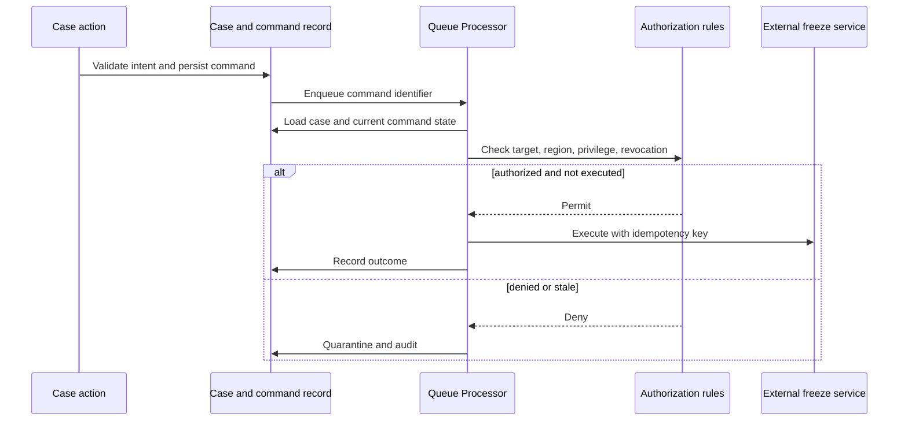

# Controlling privileges for background processing

**Audience:** Pega Lead System Architects and platform engineers. Design guidance is not a claim of laboratory validation.

A financial crime team routes suspicious-account investigations to a Queue Processor. Interactive analysts can only access cases for their region, but a worker runs under a broadly privileged service operator. A defect in a queued payload supplies another region's case key. The worker successfully writes the wrong case and invokes a freeze-account connector. No interactive screen is involved, so role-based UI testing misses the incident.

The design principle is that asynchronous execution changes the identity context, not the authorization obligation. A queue item is a request to attempt work, not proof that the originator was authorized to perform every eventual side effect.

## Authority model

Separate three principals: the human or service initiating the command, the technical operator executing the background task, and the business authority that permits the operation. Record a validated initiating identity and scope as immutable business metadata, but do not assume the initiator's access group can be reused later. Re-evaluate current authorization for the target case and the intended action when the worker runs. Define an explicit policy for revoked initiators: cancel, reassign to an authorized business role or continue under an independently approved service mandate.

Configure the queue processor and its processing activity with the minimum operational access needed to load the work and execute the approved operation. Access groups, roles, Access of Role to Object, privileges and Access Control Policy rules protect different layers. A service operator with permission to read a work class must not automatically have authority to invoke an irreversible connector. Use a business command type allowlist and an explicit authorization decision before side effects.

## Implementation steps

1. Model a command data object with CommandID, CaseKey, Operation, TenantOrRegion, RequestedBy, RequestedAt, AuthorizationBasis, Version and Status. Never serialize a full user clipboard into the queue item.
2. On the flow action, use a Validate rule and decision rules to check required facts. Commit the intended business state before handing work to an asynchronous processor using the supported enqueue mechanism for the target release.
3. Define a dedicated worker access group. Document every class, data page, privilege and integration profile it requires. Remove administrator roles and interactive-only entitlements.
4. In the processor activity, reload the authoritative case, verify its current state and tenant, and evaluate a narrowly scoped When or decision rule for the requested operation. Reject unknown command types.
5. Apply Access Control Policy rules to Work-, Data- or Assign- instances where row-level constraints are needed. Test checked-in rules, since uncommitted policy changes may not affect runtime behavior.
6. Separate connector authentication from operator authorization. Store connector credentials in managed authentication configuration, not in queue payloads, activities or dynamic system settings containing cleartext secrets.
7. Persist an idempotency marker keyed to CommandID before or in coordination with side effects. Define recovery when the external system succeeds but the Pega status update fails.
8. Route denied or malformed items to an operational review state with safe metadata. Do not repeatedly retry permanent authorization failures.
9. Establish audit reports for unusual cross-region attempts and privilege changes affecting queued commands.

## Tradeoffs and failure mechanics

A single high-privilege service identity is easy to operate but makes application mistakes high impact. Per-region worker identities can reduce blast radius, at the cost of more routing, credentials and capacity planning. Rechecking the original user's privileges on execution is strict but can block legitimate long-running mandates; explicit business delegation is preferable to silent privilege inheritance.

A retry may occur hours after the originator loses access or the case changes ownership. If the processor only checks the original approved flag, it can still perform an unauthorized action. A second failure is a time-of-check/time-of-use race: authorization succeeds, then the case is reassigned before the connector call. Use locking or a case version check for the state being acted on, and make external effects reconcilable. Never assume a Pega database rollback can reverse an external freeze operation.

## Reproducible verification matrix

| Test | Execution | Expected result |
| --- | --- | --- |
| Cross-region payload | Enqueue Region B key from Region A initiator | Denied before connector |
| Revoked initiator | Revoke privilege before delayed execution | Explicit configured revocation policy enforced |
| Privileged worker | Invoke unapproved command type | Denied despite worker access |
| Case reassigned | Change owner between enqueue and run | Revalidated or quarantined |
| Duplicate delivery | Execute CommandID twice | At most one external business effect |
| External success, DB failure | Fail status persistence after connector success | Reconciliation finds completed operation |
| Missing metadata | Strip region from command | Fail closed with audit evidence |

## Operations and version note

Track queue age, authorization denials, connector outcomes and reconciliation backlog independently. Queue Processor facilities and service-operator behavior vary by Pega Platform release and hosting model; validate the exact worker context in a non-production environment.

**Primary reference:** [Pega Platform: creating an access control policy](https://docs.pega.com/bundle/platform-23/page/platform/security/create-access-control-policy.html).
