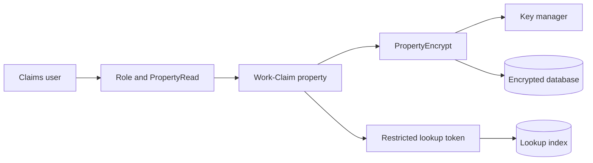

# Sensitive Field Encryption and Key Management

## Enterprise failure scenario

A claims application exposes bank-account data through a reporting replica. Masking the case view leaves the plaintext database column untouched. A subsequent field-encryption change breaks the fraud team's range report and an old export activity continues sending cleartext. The real boundary crosses storage, rule-based authorisation, downstream copies, encryption keys and query design.

## Architecture decision and Pega rule boundary

Model separate controls: PropertyEncrypt access control policy for sensitive Work-/Data- class properties; PropertyRead masking for roles; Read/Update policies for case access; managed encryption keys; and a purpose-built restricted lookup reference where equality search is unavoidable. PropertyEncrypt is not a substitute for PropertyRead. Pega documents report filtering restrictions, embedded-property policy placement and ciphertext column sizing. Validate all details against the installed version.

## Implementation in order

1. Inventory sensitive properties, their class paths, exposed columns, data transforms, service payloads, reports, exports and archival copies. Record a named data owner for each copy.

2. Define PropertyEncrypt at the correct class and property level, including embedded paths where the installed version requires multiple policies. Choose approved key storage and access boundaries.

3. Define PropertyRead masking for front-line users and stronger Read/Update case policies. Test both direct case access and report/search results, not only the rendered form.

4. Redesign reports that sort, aggregate or range-filter encrypted values. A restricted tokenised equality lookup may be justified; never use an unprotected hash as a universal substitute.

5. Increase exposed column capacity for ciphertext expansion and plan migration of existing plaintext rows with reversible batches, reconciliation and secured temporary storage.

6. Test key rotation while old cases remain readable, node caches refresh and one key provider endpoint is unavailable. Fail closed on encryption failures.

7. Review background activities, connectors and data flows for inadvertent cleartext materialisation. Never enable broad clipboard logging to troubleshoot sensitive data.

## Failure mechanics in production

A legitimate UI control may decrypt a field for an authorised user, so at-rest encryption does not prevent misuse of excessive privileges. Ciphertext truncation can surface only after a long real-world value. An old report definition may silently lose a supported filter. A stale node key configuration can make reads intermittent after rotation. Data flows that use unsupported clipboard modes require specific review. Plaintext copies in attachment metadata or exports are outside the original property policy.

## Design tradeoffs

- Database-wide encryption is easy to operate but does not protect against privileged database queries; field encryption narrows that exposure at the cost of reporting constraints.
- A separate search token restores a business operation but becomes another correlation asset needing retention and access controls.
- External key management improves central audit but creates an availability dependency and a complex recovery procedure.

## Reproducible verification matrix

Run these checks with synthetic data in a controlled test environment. Capture the application version, ruleset stack, requestor identity, test stimulus and expected persisted outcome. These are proposed checks, not executed results.

| Test and stimulus | Expected result and evidence |
| --- | --- |
| Read a protected column in database replica | No original bank account cleartext |
| Unprivileged operator opens authorised case | Field masked; unrelated sensitive cases denied |
| Fraud operator uses approved view | Explicitly permitted value displayed and access audited |
| Run legacy range report | Unsupported filter rejected or replaced with documented design |
| Rotate key while cases remain open | Old and new records decrypt through approved mechanism |
| Disable key provider in test | Sensitive writes fail closed, no plaintext fallback |
| Migrate legacy rows twice | Second run idempotent; counts and audit reconcile |

## Incident runbook

If decryption fails, compare key identifiers, affected nodes, ciphertext lengths and the time of rotation before reprocessing. Stop migration before attempting restoration. Incident logs must contain case references and error classes, not the decrypted values. A security reviewer approves any temporary recovery key exposure.

## LSA release acceptance and limitations

A release gate must include a sample of legacy records, worst-case field lengths, a replica inspection, negative authorisation tests and evidence of encrypted backups. Record the precise Pega release and supported policy behaviour; PropertyEncrypt and reporting capabilities are not assumed identical across versions.

The architecture is design-backed and laboratory verification remains pending. A technical reviewer should inspect rule resolution, authorisation, Pega guardrail warnings, negative-path behaviour and rollback feasibility before promoting it. Capture controlled Tracer or PDC evidence only where available, and exclude sensitive clipboard content from shared logs. Do not interpret a diagram as evidence that the implementation has been tested.

## Verified Pega primary references

- [Pega access control policies](https://docs.pega.com/bundle/platform-23/page/platform/security/create-access-control-policy.html)
- [Pega Obj-Browse limitations](https://docs.pega.com/bundle/platform-23/page/platform/reference/methods/obj-browse.html)
