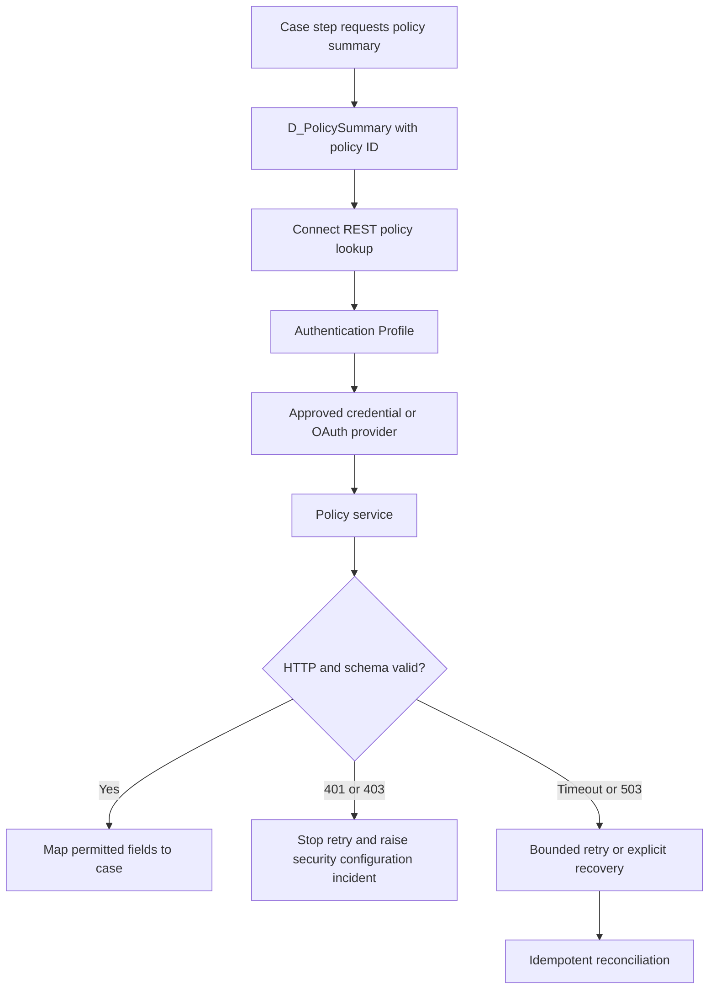

# Secrets management for integration connectors

## Failure scenario: a credential rotation that stops claims adjudication

An insurer uses Pega Platform to open claim cases and invoke a policy service with a Connect REST rule. A developer once entered a service password into an authentication profile and then copied that configuration between environments. When the policy service rotates its credential, the development environment continues working, but production starts returning HTTP 401. Operations retries the failed cases, multiplying requests and generating an incident with an unclear recovery point. A copied secret is also visible in an exported diagnostic artifact. The failure is not merely a password issue: the deployment contract, token lifecycle, access controls, incident evidence and replay semantics were never designed together.

The architectural invariant is that **a Pega rule may identify a credential, but a released rule package must not become the credential's distribution channel**. Credential ownership stays with an approved enterprise secrets process. The precise supported vault and secret reference mechanism depends on the Pega Platform version and hosting model; do not assume a Pega Cloud configuration is interchangeable with a client-managed installation.

## Pega rule boundaries and ownership

- **Connect REST**: defines the operation, endpoint configuration and request/response mapping. It should not carry environment passwords or ad hoc bearer tokens in a Data Transform.
- **Authentication Profile** and, where applicable, **OAuth provider** configuration: supply supported outbound authentication to the connector. Choose OAuth 2.0 client credentials for machine-to-machine access when the service supports it, with a narrowly scoped audience.
- **Data Page** such as `D_PolicySummary[PolicyId]`: gives business rules a typed, read-only access path. Its failure handling must distinguish authentication failure from an absent policy.
- **Data Transform**: maps business fields without copying credentials into `pyWorkPage`, clipboard diagnostics, case history or a reportable property.
- **Access Group** and deployment roles: restrict who can inspect or change integration configuration. A business operator should not receive secret-management privileges.
- **Queue Processor**: handles recoverable follow-up work, but only with idempotency and a bounded retry policy. A 401 after rotation is generally a configuration incident, not a reason to replay indefinitely.

The source of truth for the secret, its owner, expiry and rotation window must be recorded outside the case payload. A stable logical profile name can differ from the physical secret identifier. Avoid logging token values, authorization headers, client secrets or full connector request bodies.

## Proposed control flow

## Architecture and implementation sequence

1. **Classify each connector** by business owner, data classification, endpoint, required OAuth scope, credential owner, rotation interval and whether a human session may trigger it. Record a dependency register, not a spreadsheet of secrets.
2. **Create an environment-specific integration contract**. The same Connect REST rule can use different endpoint and authentication configuration per environment, but the deployment pipeline must validate that the target profile exists before opening traffic. Avoid hard-coded URL strings in activities.
3. **Configure the authentication mechanism** using the supported Authentication Profile and OAuth provider capabilities for the installed release. Use service identities rather than personal operators. If a vault integration is required, validate its documented support with platform operations rather than introducing custom Java secret retrieval.
4. **Minimize scope and lifetime**. Ask the service owner for a token audience restricted to policy read operations. Set token caching and renewal according to supported platform behavior and provider expiry. Never assume an old token is invalidated instantly when a secret rotates.
5. **Design a dual-credential rotation window** if the provider supports it. Provision new credentials, test a canary call from production with a non-sensitive test identifier, switch the active reference, verify requests, then revoke the old credential. If overlap is prohibited, schedule an explicit outage or fail-closed period.
6. **Separate error classes**. Treat 401/403 as security or permission failures requiring intervention; treat 429 with provider-specific backoff; treat 5xx/timeouts as possibly transient; treat malformed successful responses as contract violations. A Data Page must not cache an authorization failure as a valid business result.
7. **Protect evidence**. Correlate requests with a non-secret request ID, connector rule name, profile alias, HTTP status, environment and deployment ID. Scrub authorization headers in Tracer exports, PDC attachments and central logs before sharing.
8. **Build recovery controls**. After a corrected profile is deployed, reconcile cases against the external service before replay. A previous timed-out call might already have committed remotely. Use a business idempotency key for operations that mutate external state.

## Tradeoffs that matter

A shared integration identity simplifies operations but increases blast radius. Per-domain identities isolate compromise and rate limits but add rotation overhead. OAuth client credentials reduce password handling when supported, yet token caching and provider availability become dependencies. Short token lifetimes improve containment but increase refresh traffic. A custom vault connector may appear flexible while creating an unsupported runtime and upgrade dependency. Prefer the product-supported mechanism and document the exception if one is unavoidable.

Keeping a connector synchronous simplifies immediate user feedback but makes the case step dependent on identity-provider latency. An asynchronous request can protect interaction time, yet requires status tracking, idempotency and business-visible pending states. Neither option makes a lost credential safe to ignore.

## Production failure mechanics and recovery

On a rotation failure, first compare the **credential reference and scope**, not the secret value, across environments. Inspect sanitized connector status and OAuth failure codes, confirm the external service's authentication policy, and identify the first failing deployment or rotation event. Pause automated retries if the failure is deterministic. Check whether other connectors share the same profile. Restore service using the approved credential procedure, then reconcile all affected case IDs before selectively resuming work. Record who authorized the change and when the old credential was revoked. Do not paste production secrets into an incident ticket.

## Reproducible verification matrix

| Test | Setup and action | Required evidence and pass condition |
| --- | --- | --- |
| Normal authentication | Valid profile, permitted service identity | Connector returns mapped policy fields; no secret on work page |
| Rotated secret | Disable old credential, activate new reference | New requests succeed without editing business rules |
| Expired token | Force token expiry in test provider | Supported renewal or controlled failure, no infinite loop |
| Wrong OAuth scope | Remove policy-read permission | 403 remains distinct from policy-not-found |
| Invalid secret | Use a revoked credential in test | 401 triggers alert and bounded failure, not a replay storm |
| Timeout after remote write | Simulate lost response to mutation | Reconciliation prevents a duplicate external change |
| Audit export | Export sanitized diagnostics | No Authorization header, token or secret value present |

**Verification status:** Architecture design and test specification only. No production credential, live connector test, benchmark or screenshot is claimed.

## Primary reference

- [Pega Platform authentication, including outbound connector authentication profiles](https://docs.pega.com/bundle/platform-241/page/platform/security/authentication.html). Check the documentation selector for the deployed release before implementing.
