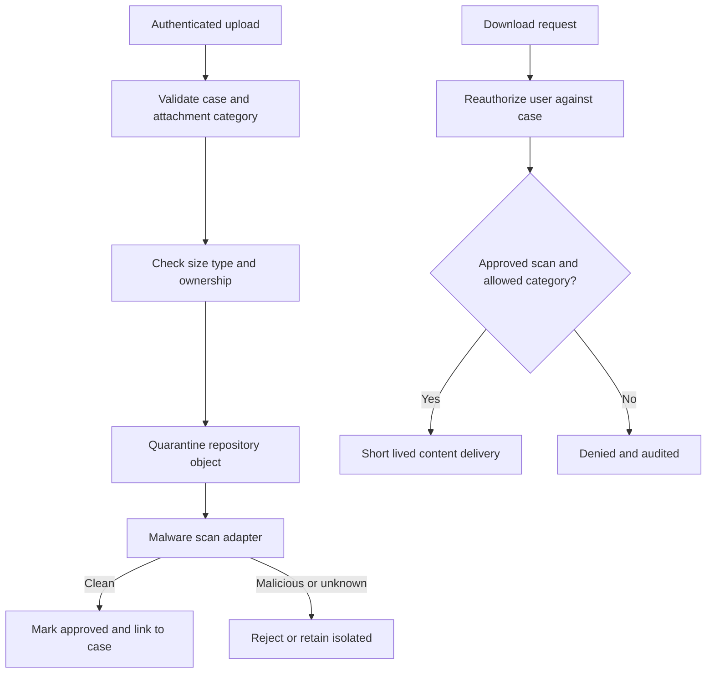

# Attachment access controls and malware checks

## Failure that exposes the architecture
An insurer receives supporting evidence for a fraud investigation. A claims handler uploads a PDF to a case, then a second handler copies its attachment URL into a customer email. The recipient can open the file even after the first handler loses access. Separately, a compressed attachment contains malware, but a custom download service streams it directly from storage before the antivirus result arrives. The two defects share one root cause: attachment metadata was treated as proof of authorization and safety.

## Trust boundaries and Pega objects
Model the case as the authorization boundary, not the storage object key. A case attachment may involve a case link and a content object in a repository. Configure attachment categories, case-type attachment settings and role-specific access, then enforce access again at the retrieval endpoint. Use Access Roles, Access of Role to Object rules and, where justified, Access Control Policies for row-level restrictions. Never rely on a hidden attachment button or a client-supplied case identifier as a security control. A service that accepts a repository path is especially dangerous: it can bypass case visibility, ownership and category constraints.

The design separates four states: uploaded, scanning, approved and rejected. These are **application states**, not a claim that Pega ships a universal attachment quarantine state machine. An implementation must connect its chosen malware scanner to the attachment lifecycle and prevent reads before an approved scan. Define a retention and legal-hold policy independently of case resolution.

## Implementation sequence
1. Inventory every upload and download path: standard case UI, DX API, service REST, bulk imports, email listeners and any direct repository integrations. Include anonymous or externally authenticated channels. The architecture is incomplete if only the visible portal is secured.
2. Define a matrix of attachment category, operator role, case status, jurisdiction and allowed operations. Make the sensitive categories unavailable to users lacking the required case access. Verify a removed role takes effect in a new request and consider existing sessions and cached links.
3. Use supported attachment configuration and repository storage for the installed Pega release. For external storage, do not expose raw object paths to browsers. Use server-side identity and short-lived access where the storage platform permits it.
4. Apply ingress limits at the gateway and Pega layer. In Pega Platform '24.2, Pega documents `prconfig/Initialization/MaximumFileUploadSizeMB/default` and `pyMaxDragDropAttachSizeMB`; the effective limit is the smaller applicable value. Do not assume these settings alone cover every custom endpoint.
5. Integrate a scanner at a supported attachment extension point, or use a controlled intake service if the platform/version cannot guarantee pre-download quarantine. Persist scan status, signature/version, checksum and immutable correlation ID. Scanner outage must fail closed for downloads, not silently approve content.
6. Add audit events for denied downloads, malware findings, administrative overrides and deletion. Exclude filenames containing personal information from unrestricted logs. Ensure security staff can retrieve evidence without granting general case access.
7. Test retention, object deletion and orphaned links separately. A case link removed from Pega does not prove that an external object has been destroyed.

## Production failure mechanics and tradeoffs
Inline scanning reduces the exposure window but can make interactive uploads slow or timeout. Asynchronous scanning improves responsiveness but requires a genuine quarantine boundary. Object-store signed URLs reduce application streaming cost but can outlive an operator's access revocation. Prefer short expiry and avoid distributing reusable URLs. Repository storage reduces database BLOB pressure, yet increases the importance of identity, lifecycle and backup consistency.

Do not infer a clean scan from HTTP 200 on upload. The upload may only have stored a temporary object. Do not infer that a 403 proves full security either: attempt direct object access and cross-case reference substitution. For regulated data, classify the file's contents as well as its metadata, and coordinate legal holds with storage retention.

## Reproducible verification matrix
| Experiment | Setup | Required result | Evidence |
|---|---|---|---|
| Cross-case access | User A can see Case A, not B | B's attachment download denied | API status and security audit |
| Revocation | Revoke A's role after initial view | Subsequent request denied | Session and request timestamps |
| Scanner down | Disable scanner in test | No content can be retrieved | Quarantine status and response |
| Malicious test file | Approved antivirus test fixture | File rejected, not case-linked as clean | Scanner verdict and link query |
| Oversized upload | Exceed smallest enforced limit | Explicit rejection, no orphan object | Gateway and repository logs |
| Duplicate name | Upload same name twice | No silent replacement | Attachment IDs and checksums |
| Signed URL reuse | Reuse URL after expiry | Storage denies request | Storage access log |

These are **test specifications**, not observed test results. Validate release-specific hooks and DX API behavior in the target installation before implementation.

## Verified Pega references
- [Best practices and known issues for large file attachments, Platform '24.2](https://docs.pega.com/bundle/platform-242/page/platform/case-management/large-file-attachment-handling-across-ui-frameworks.html)
- [Storing case attachments using external storage, Platform '23](https://docs.pega.com/bundle/platform-23/page/platform/case-management/storing-case-attachments-using-external.html)
