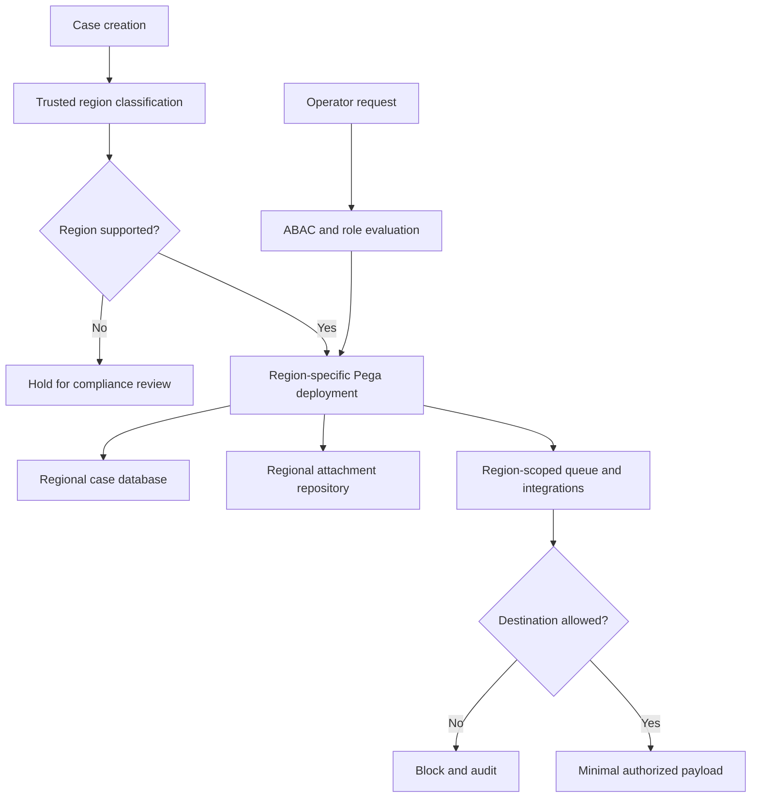

# Handling cross-border data residency constraints
## The failure
A multinational insurer operates one Pega case application for EU and UK claims. A UK agent opens a French claim and the screen correctly hides medical details, but a node-scoped data page holds the same customer profile for a later UK requestor. A nightly queue processor also sends attachment metadata and full addresses to a non-EU analytics endpoint. The design passed UI security testing because it confused authorization with data location. Data residency is an end-to-end property of storage, processing, backup, logs and support access, not merely a case-view filter.

## Pega-specific boundaries
Represent jurisdiction as an immutable, validated case attribute, for example `.DataResidencyRegion`, populated from an authoritative policy or customer record. Do not trust a browser parameter. A Work- case class can have Access Control Policy rules for Read and Update, with Access Control Policy Condition rules comparing operator entitlements to the case region. Access roles and privileges remain necessary for function-level permissions; ABAC is not a substitute for geographic placement. An Access Control Policy does not move a database row, attachment, queue item or backup into a permitted region.

Classify each data page by source, scope, parameters, sensitivity and geographic affinity. A node-scoped `D_CustomerProfile` containing regional personal data can cross operator boundaries if the cache key and deployment topology are wrong. Prefer requestor or thread scope when data is identity-specific, or explicitly partition region and tenant and prove cache isolation. Validate whether the installed Pega release and hosting model provide physically separate clusters and regional repositories; never infer regional separation from rulesets or access groups.

## Implementation decisions
1. Create a data-flow inventory for `Work-`, `Data-`, `Index-`, attachments, search indexes, queue processor payloads, reporting replicas, Pega logs and third-party monitoring. Record country, legal basis, retention, encryption keys and privileged support access for every copy.
2. Decide deployment boundaries before building rules. If legal obligations require in-region execution, use separate approved regional runtime, database and object-store infrastructure. An access control rule cannot enforce a hosting contract.
3. Derive `.DataResidencyRegion` from a server-side lookup at case intake, record classification provenance and prevent ordinary users from editing it. Cross-region transfer is a governed process with approval and a migration ledger, not a Data Transform changing one property.
4. Implement read/update authorization using Access Control Policies on appropriate classes, supplemented by Access Roles to Object and privileges for service and batch execution. Exercise every channel, including Service REST and background requestors.
5. Define region-aware `D_CustomerProfile[CustomerID,Region]` only where cache scope and parameter validation can be proved. For sensitive per-operator results, choose requestor or thread scope. Ensure Connect REST authentication profiles, endpoint configuration and response mappings are regional.
6. Route Queue Processor work to a regional execution environment; minimize queued clipboard content and verify delayed jobs never reference an inaccessible remote case. Use identifiers rather than copied medical records wherever possible.
7. Separate analytics export from transactional data. Approve individual fields and destinations, tokenize identifiers, test deletion and legal-hold semantics, and redact PII from Tracer, exception logging and alert payloads.
8. Maintain an evidence pack: topology diagram, supplier subprocessor register, residency test cases, approved transfer mechanism and quarterly drift checks.

## Tradeoffs and failure mechanics
Regional clusters increase deployment and operational costs and complicate cross-border customer service. A single global cluster is simpler but may not meet data-location obligations even with perfect ABAC. Federated searches should return the minimum allowed metadata and then route authorized access to the owning region. Replication for resilience must honor the same boundaries as primary storage. Key location alone does not prove where plaintext processing occurs.

A dangerous incident pattern is an asynchronous failure path: a connector times out, an activity writes the complete request payload to an unrestricted log, and a centralized collector replicates it overseas. Another is a case transfer that updates the region field but leaves attachments, search documents and old queue items behind. Detect these as explicit reconciliation failures rather than assuming an update completed.

## Reproducible verification matrix
| Test | Setup | Expected outcome | Capture |
|---|---|---|---|
| Cross-region read | UK role requests EU case via UI and API | Denied unless approved entitlement | HTTP and ABAC trace |
| Cache isolation | Two identities access same customer ID in different regions | No unauthorized data reuse | Page scope and source logs |
| Background route | Enqueue EU case with UK worker unavailable | No UK processing or export | Worker and queue evidence |
| Attachment path | Attempt direct storage URL from disallowed region | Access blocked | Storage audit |
| Connector failure | Force remote timeout | No PII in logs or fallback | Sanitized log review |
| Migration | Transfer a synthetic case | All replicas and old references reconciled | Migration ledger |
| Backup restore | Restore approved test backup | Residency policy still satisfied | Region inventory |

These are design-backed tests, not executed results. Confirm regional controls and legal interpretations with the hosting provider and privacy counsel for the exact deployment.
## Primary guidance
- [Pega access control policies, Platform '23](https://docs.pega.com/bundle/platform-23/page/platform/security/create-access-control-policy.html)
- [Creating a Data Page, Platform '25](https://docs.pega.com/bundle/platform-25/page/platform/data-integration/creating-data-page.html?workflow=creating-data-pages)
