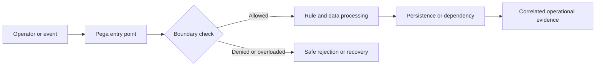

# Privilege escalation pathways through custom activities

## Engineering context and failure scenario

A claims adjuster invokes a utility activity through a button and updates a restricted settlement property on a case belonging to another business unit. The UI hides the field, but the server activity trusts a case key supplied by the browser. This is not merely a user-interface defect. In a distributed Pega application, the effective outcome depends on the access group, resolved rule versions, clipboard state, background processing and the timing of persistence or external acknowledgements. The architecture must specify which component owns the decision, what constitutes a completed operation, and which evidence can be safely retained. The example below is a design exercise, not a claim of observed production results.

## Relevant Pega building blocks

The principal platform objects and diagnostics are **Access Group, Access Role to Object (ARO), Access of Role to Object, Access When, Activity, Obj-Open-By-Handle, Obj-Save, pxUpdateDateTime, case lock**. Inspect the exact rule implementations and access configuration in the deployed Pega Platform version; behavior can vary by application stack, UI architecture, deployment model and patch level. Do not assume that a visual control, a connector response or an activity completion implies an authorized durable business outcome. The owner of the relevant case or integration contract must define the authoritative state and acceptable recovery actions.

**Design invariant:** Treat client-provided case identifiers and parameters as untrusted; authorize the opened instance and the intended property change on the server before persistence.

## Reference architecture

The boundary decision must happen before an irreversible side effect. Correlation IDs should cross the request, background-work and integration boundaries without carrying protected business payloads. An explicit rejection or pending state is preferable to silently discarding work. Where the decision spans multiple systems, document the transaction boundary and recovery contract instead of promising an atomic commit across services.

## Step-by-step implementation

### 1. Inventory every custom Activity callable from UI actions, services, agents or Queue Processors

Inventory every custom Activity callable from UI actions, services, agents or Queue Processors; record its execution identity and whether it opens or writes a work object. Record the responsible rule, configuration owner and expected observable outcome in an architecture decision record. Review whether the behavior is synchronous, asynchronous or eventually consistent, and specify the authorization context for each execution path. Avoid coupling the check to a single screen or portal implementation; direct services and resumed background work require equivalent controls.

### 2. For each entry point, determine the authenticated operator's access group, applicable roles, case class and attribute-based access control conditions

For each entry point, determine the authenticated operator's access group, applicable roles, case class and attribute-based access control conditions; do not equate a hidden control with authorization. Record the responsible rule, configuration owner and expected observable outcome in an architecture decision record. Review whether the behavior is synchronous, asynchronous or eventually consistent, and specify the authorization context for each execution path. Avoid coupling the check to a single screen or portal implementation; direct services and resumed background work require equivalent controls.

### 3. Refactor direct persistence behind a single checked operation that opens the work object, checks class and instance access, checks the permitted transition and obtains a lock before modification

Refactor direct persistence behind a single checked operation that opens the work object, checks class and instance access, checks the permitted transition and obtains a lock before modification. Record the responsible rule, configuration owner and expected observable outcome in an architecture decision record. Review whether the behavior is synchronous, asynchronous or eventually consistent, and specify the authorization context for each execution path. Avoid coupling the check to a single screen or portal implementation; direct services and resumed background work require equivalent controls.

### 4. Whitelist mutable properties and validate expected status, tenant and assignment ownership. Reject arbitrary clipboard page names, class names and handles passed from the client

Whitelist mutable properties and validate expected status, tenant and assignment ownership. Reject arbitrary clipboard page names, class names and handles passed from the client. Record the responsible rule, configuration owner and expected observable outcome in an architecture decision record. Review whether the behavior is synchronous, asynchronous or eventually consistent, and specify the authorization context for each execution path. Avoid coupling the check to a single screen or portal implementation; direct services and resumed background work require equivalent controls.

### 5. Enforce least-privilege access roles for activity execution and object modification

Enforce least-privilege access roles for activity execution and object modification; review privileged utility activities inherited from framework layers. Record the responsible rule, configuration owner and expected observable outcome in an architecture decision record. Review whether the behavior is synchronous, asynchronous or eventually consistent, and specify the authorization context for each execution path. Avoid coupling the check to a single screen or portal implementation; direct services and resumed background work require equivalent controls.

### 6. Record a minimal security event containing correlation ID, action, rule version and decision, never the protected field values

Record a minimal security event containing correlation ID, action, rule version and decision, never the protected field values. Record the responsible rule, configuration owner and expected observable outcome in an architecture decision record. Review whether the behavior is synchronous, asynchronous or eventually consistent, and specify the authorization context for each execution path. Avoid coupling the check to a single screen or portal implementation; direct services and resumed background work require equivalent controls.

## Design alternatives and trade-offs

A centralized mutation service reduces inconsistent checks but creates an additional dependency; repeated in-activity checks are harder to maintain and audit. An architecture review should compare the primary option against a simpler baseline using operational complexity, rollback safety, failure isolation, data sensitivity and support burden. Document what the team deliberately does not automate, especially recovery operations that could produce duplicate business actions. Favor reversible configuration changes and a narrow rollout cohort when the failure mode has not been reproduced in a controlled environment.

## Production failure mechanics

A custom activity may run with elevated service identity, a stale access group, or a framework rule override. A check made before opening the actual instance permits cross-tenant access; saving without locking can also overwrite authorized changes. In incident response, distinguish the original triggering event from secondary effects such as retries, stale cache entries, inconsistent sessions or operator rework. Collect a sanitized timeline with request correlation, effective ruleset, node or execution context, queue state and final persistence outcome. Do not infer root cause from a single error message. An apparently successful connector invocation may be followed by a failed commit, and a displayed stale value may conceal a correct committed write.

## Reproducible verification matrix

| Experiment | Setup and stimulus | Expected evidence | Failure interpretation |
|---|---|---|---|
| V1: Authorized adjuster changes permitted property | Seed synthetic data, pin access group and rule versions, then execute the scenario | Correlated trace, authoritative state, safe error category and pass/fail assertion | Compare rule resolution, boundary decision, transaction or queue outcome |
| V2: Different business unit attempts same case key | Seed synthetic data, pin access group and rule versions, then execute the scenario | Correlated trace, authoritative state, safe error category and pass/fail assertion | Compare rule resolution, boundary decision, transaction or queue outcome |
| V3: Read-only role invokes activity URL directly | Seed synthetic data, pin access group and rule versions, then execute the scenario | Correlated trace, authoritative state, safe error category and pass/fail assertion | Compare rule resolution, boundary decision, transaction or queue outcome |
| V4: Forged class and page parameters | Seed synthetic data, pin access group and rule versions, then execute the scenario | Correlated trace, authoritative state, safe error category and pass/fail assertion | Compare rule resolution, boundary decision, transaction or queue outcome |
| V5: Concurrent update and lost-lock attempt | Seed synthetic data, pin access group and rule versions, then execute the scenario | Correlated trace, authoritative state, safe error category and pass/fail assertion | Compare rule resolution, boundary decision, transaction or queue outcome |

Use a version-pinned nonproduction environment with synthetic records. Capture the test input, operator role, application version, rule versions, node type and relevant configuration. Run each experiment both before and after the proposed change, and include a negative test that attempts to bypass the intended UI path. A test passes only when both the business outcome and the security or recovery invariant are satisfied. Do not substitute screenshots for assertions on persisted state, access decisions or integration side effects.

## Operations and rollback

Monitor **denied mutation counts by operation, anomalous cross-business-unit case access, activity execution errors, authorization decision audit trail**. Agree on an alert owner, escalation window and a documented safe action for each signal. During rollout, use a limited cohort and compare error categories and latency distributions against a recorded baseline rather than a fabricated numerical target. If rollback is required, first identify work already committed or dispatched; reverting rules alone cannot undo external side effects. Keep a replay ledger or idempotency reference for any controlled reprocessing, and audit who approved a manual repair.

## Architecture review checklist

- Is the authoritative state and execution identity explicit at each boundary?
- Are negative paths and direct API or background entry points covered?
- Are logs and diagnostics free of customer payloads and credentials?
- Can support distinguish delayed, rejected, duplicated and committed work?
- Does rollback preserve compatibility with open cases and queued items?
- Are performance and security assumptions testable in the actual platform version?

## Verification status and further reading

**Design-backed, lab verification pending.** The matrix specifies experiments to execute; no lab run, benchmark or platform-version certification is claimed. Use your licensed platform's matching-version documentation for rule configuration and security semantics. Official primary documentation: [Pega Documentation](https://docs.pega.com/) and [Pega Academy](https://academy.pega.com/). Review the actual deployment's supported feature set before adopting these patterns.
