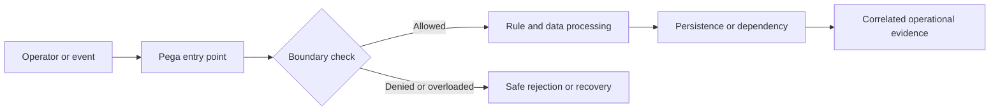

# Security regression testing during application upgrades

## Engineering context and failure scenario

A platform upgrade changes a UI implementation and a restricted case action becomes reachable through a direct API request, although the old UI regression suite still passes. This is not merely a user-interface defect. In a distributed Pega application, the effective outcome depends on the access group, resolved rule versions, clipboard state, background processing and the timing of persistence or external acknowledgements. The architecture must specify which component owns the decision, what constitutes a completed operation, and which evidence can be safely retained. The example below is a design exercise, not a claim of observed production results.

## Relevant Pega building blocks

The principal platform objects and diagnostics are **PegaUnit, scenario tests, Access Group, ARO, Access When, attribute-based access control, authentication service, DX API, RuleSet versions**. Inspect the exact rule implementations and access configuration in the deployed Pega Platform version; behavior can vary by application stack, UI architecture, deployment model and patch level. Do not assume that a visual control, a connector response or an activity completion implies an authorized durable business outcome. The owner of the relevant case or integration contract must define the authoritative state and acceptable recovery actions.

**Design invariant:** Test server-side authorization at API and rule boundaries, not only the visibility of a button in a browser.

## Reference architecture

The boundary decision must happen before an irreversible side effect. Correlation IDs should cross the request, background-work and integration boundaries without carrying protected business payloads. An explicit rejection or pending state is preferable to silently discarding work. Where the decision spans multiple systems, document the transaction boundary and recovery contract instead of promising an atomic commit across services.

## Step-by-step implementation

### 1. Baseline supported platform versions, authentication configuration, access groups, roles, privileges, rule resolution and security-related hotfixes

Baseline supported platform versions, authentication configuration, access groups, roles, privileges, rule resolution and security-related hotfixes. Record the responsible rule, configuration owner and expected observable outcome in an architecture decision record. Review whether the behavior is synchronous, asynchronous or eventually consistent, and specify the authorization context for each execution path. Avoid coupling the check to a single screen or portal implementation; direct services and resumed background work require equivalent controls.

### 2. Create a role-to-action matrix covering operator, supervisor, service identity and unauthenticated clients across create, read, update, attach and approve operations

Create a role-to-action matrix covering operator, supervisor, service identity and unauthenticated clients across create, read, update, attach and approve operations. Record the responsible rule, configuration owner and expected observable outcome in an architecture decision record. Review whether the behavior is synchronous, asynchronous or eventually consistent, and specify the authorization context for each execution path. Avoid coupling the check to a single screen or portal implementation; direct services and resumed background work require equivalent controls.

### 3. Capture positive and negative cases at both UI and API boundaries with synthetic cases and no production personal data

Capture positive and negative cases at both UI and API boundaries with synthetic cases and no production personal data. Record the responsible rule, configuration owner and expected observable outcome in an architecture decision record. Review whether the behavior is synchronous, asynchronous or eventually consistent, and specify the authorization context for each execution path. Avoid coupling the check to a single screen or portal implementation; direct services and resumed background work require equivalent controls.

### 4. Pin representative application and framework ruleset versions, and compare effective access decisions before and after upgrade

Pin representative application and framework ruleset versions, and compare effective access decisions before and after upgrade. Record the responsible rule, configuration owner and expected observable outcome in an architecture decision record. Review whether the behavior is synchronous, asynchronous or eventually consistent, and specify the authorization context for each execution path. Avoid coupling the check to a single screen or portal implementation; direct services and resumed background work require equivalent controls.

### 5. Run PegaUnit tests for decision and access helper rules, integration contract tests for endpoints and end-to-end tests for protected journeys

Run PegaUnit tests for decision and access helper rules, integration contract tests for endpoints and end-to-end tests for protected journeys. Record the responsible rule, configuration owner and expected observable outcome in an architecture decision record. Review whether the behavior is synchronous, asynchronous or eventually consistent, and specify the authorization context for each execution path. Avoid coupling the check to a single screen or portal implementation; direct services and resumed background work require equivalent controls.

### 6. Triage differences as intended platform behavior, application regression or test-environment configuration drift

Triage differences as intended platform behavior, application regression or test-environment configuration drift; record the evidence and remediation owner. Record the responsible rule, configuration owner and expected observable outcome in an architecture decision record. Review whether the behavior is synchronous, asynchronous or eventually consistent, and specify the authorization context for each execution path. Avoid coupling the check to a single screen or portal implementation; direct services and resumed background work require equivalent controls.

## Design alternatives and trade-offs

Broad end-to-end coverage catches integration faults but is slow and brittle; narrow unit tests are fast but cannot prove endpoint authorization. An architecture review should compare the primary option against a simpler baseline using operational complexity, rollback safety, failure isolation, data sensitivity and support burden. Document what the team deliberately does not automate, especially recovery operations that could produce duplicate business actions. Favor reversible configuration changes and a narrow rollout cohort when the failure mode has not been reproduced in a controlled environment.

## Production failure mechanics

A successful UI test can conceal unauthorized direct requests. Cached privileges, changed service package mappings or different test operator records produce misleading pass results. In incident response, distinguish the original triggering event from secondary effects such as retries, stale cache entries, inconsistent sessions or operator rework. Collect a sanitized timeline with request correlation, effective ruleset, node or execution context, queue state and final persistence outcome. Do not infer root cause from a single error message. An apparently successful connector invocation may be followed by a failed commit, and a displayed stale value may conceal a correct committed write.

## Reproducible verification matrix

| Experiment | Setup and stimulus | Expected evidence | Failure interpretation |
|---|---|---|---|
| V1: Authorized and unauthorized read | Seed synthetic data, pin access group and rule versions, then execute the scenario | Correlated trace, authoritative state, safe error category and pass/fail assertion | Compare rule resolution, boundary decision, transaction or queue outcome |
| V2: Forbidden property mutation via API | Seed synthetic data, pin access group and rule versions, then execute the scenario | Correlated trace, authoritative state, safe error category and pass/fail assertion | Compare rule resolution, boundary decision, transaction or queue outcome |
| V3: Session expiry and reauthentication | Seed synthetic data, pin access group and rule versions, then execute the scenario | Correlated trace, authoritative state, safe error category and pass/fail assertion | Compare rule resolution, boundary decision, transaction or queue outcome |
| V4: Service operator with reduced privileges | Seed synthetic data, pin access group and rule versions, then execute the scenario | Correlated trace, authoritative state, safe error category and pass/fail assertion | Compare rule resolution, boundary decision, transaction or queue outcome |
| V5: Rule override under upgraded ruleset stack | Seed synthetic data, pin access group and rule versions, then execute the scenario | Correlated trace, authoritative state, safe error category and pass/fail assertion | Compare rule resolution, boundary decision, transaction or queue outcome |

Use a version-pinned nonproduction environment with synthetic records. Capture the test input, operator role, application version, rule versions, node type and relevant configuration. Run each experiment both before and after the proposed change, and include a negative test that attempts to bypass the intended UI path. A test passes only when both the business outcome and the security or recovery invariant are satisfied. Do not substitute screenshots for assertions on persisted state, access decisions or integration side effects.

## Operations and rollback

Monitor **security regression failures by access group, unexpected HTTP success on negative cases, changes in effective access matrices**. Agree on an alert owner, escalation window and a documented safe action for each signal. During rollout, use a limited cohort and compare error categories and latency distributions against a recorded baseline rather than a fabricated numerical target. If rollback is required, first identify work already committed or dispatched; reverting rules alone cannot undo external side effects. Keep a replay ledger or idempotency reference for any controlled reprocessing, and audit who approved a manual repair.

## Architecture review checklist

- Is the authoritative state and execution identity explicit at each boundary?
- Are negative paths and direct API or background entry points covered?
- Are logs and diagnostics free of customer payloads and credentials?
- Can support distinguish delayed, rejected, duplicated and committed work?
- Does rollback preserve compatibility with open cases and queued items?
- Are performance and security assumptions testable in the actual platform version?

## Verification status and further reading

**Design-backed, lab verification pending.** The matrix specifies experiments to execute; no lab run, benchmark or platform-version certification is claimed. Use your licensed platform's matching-version documentation for rule configuration and security semantics. Official primary documentation: [Pega Documentation](https://docs.pega.com/) and [Pega Academy](https://academy.pega.com/). Review the actual deployment's supported feature set before adopting these patterns.
