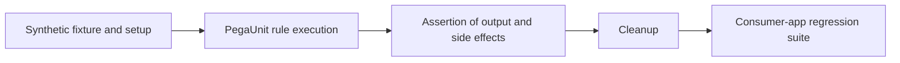

# PegaUnit Contracts: Testing Shared Rules Without Copying Production Data

**PFA-196** | Senior / Lead System Architect level | Design reference, not a lab result

## The practical failure

A routing decision is shared by six case types. One team modifies it and passes a happy-path Run Rule check, but another application uses a different class and null handling. Robust reusable-rule testing requires precise input/output contracts, deterministic fixtures and consumer-level integration evidence.

## Technical flow

The diagram describes a proposed execution boundary rather than a captured Pega implementation.

## Pega rules and interfaces involved

| Rule or component | Architect's checklist |
|---|---|
| PegaUnit unit test case | Owns one part of this design |
| Setup & Cleanup tab | Requires clear data and security contract |
| Decision / Data Transform under test | Needs actual release-specific configuration |
| Assertions | Should yield evidence for diagnostics |
| CI regression test suite | Has a testable operational responsibility |

## Implementation design

1. Map all consuming case types and document the reusable rule's input and output contract, including missing and invalid values.

2. Use PegaUnit Setup & Cleanup to create deterministic test data independent of a given environment's production records.

3. Provide mocks or preconfigured dependencies where a true unit test should not call a live external API.

4. Assert actual return properties, decisions and prohibited side effects, rather than treating 'rule ran' as success.

5. Test each implementation application with its actual class/ruleset context to catch rule resolution differences.

6. Separate fast isolated tests from case-lifecycle and integration tests, but require both in release gates.

7. Use deterministic time and stable synthetic IDs; remove fixtures during cleanup so runs are repeatable.

## Competing patterns

| Approach | Trade-off |
|---|---|
| Run Rule happy path only | Fast check with poor contract coverage |
| PegaUnit plus fixtures and assertions | Repeatable boundary validation |
| Full end-to-end tests alone | Wider integration confidence but slower and harder to diagnose |

A valid architecture makes the consistency, permission and recovery contract explicit. Do not optimize for one successful demonstration while ignoring the retry or failure case.

## Why it breaks in production

Tests that depend on production-like fixed case IDs or current system date become flaky. Shared data pages may retain stale test state. A test that silently calls the real partner measures external availability rather than the rule's correctness.

For incident triage, retain a redacted operation/case ID, node, ruleset/app version, timestamp and evidence of the dependent system. Never publish private client payloads or authentication tokens.

## Reproduction and verification plan

| Scenario | Evidence to obtain |
|---|---|
| Test 1 | Run empty and null inputs, verify explicit fallback. |
| Test 2 | Run two case subclasses and compare expected resolved rules. |
| Test 3 | Mock downstream failure and assert business outcome. |
| Test 4 | Run suite twice consecutively and verify no fixture contamination. |

These are proposed tests. No claim is made that the scenario has been executed in a Pega lab. A complete validated edition should show the actual Pega rule forms, configuration values and observed result for the target release.

## Release checklist

Record system of record, data and authorization boundary, expected volume, timeout/retry or conflict strategy, owner of failures, migration impact and a repair runbook. Confirm behavior across at least two realistic user/role contexts where applicable.

## Source and version note

- [Relevant Pega Academy reference](https://academy.pega.com/topic/configuring-test-data-pega-unit-test-cases/v1)

Independent original engineering content. Version-specific editor names and configuration controls must be checked against the Pega release used by the reader.
