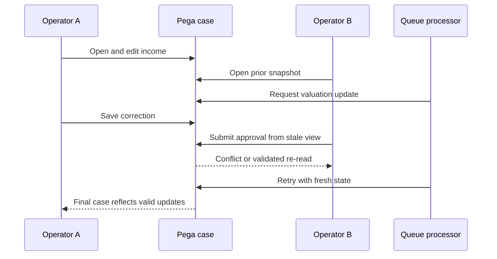

# Concurrency tests for case locking and optimistic updates

> Architecture study for Lead System Architects. The failure narrative is a hypothetical engineering scenario; no production incident or test result is claimed.

## Enterprise failure scenario

A servicing application lets two operators review the same mortgage case. Operator A corrects an income field while Operator B approves an outdated snapshot. In a separate batch, a queue processor posts a valuation update during the approval. The case appears resolved, but the latest income correction is missing. Single-user functional tests all pass because the failure requires two requestors and a controlled interleaving of reads, locks and saves.

## Architecture decision and Pega rule design

Choose the case type's locking strategy based on expected collaboration and update semantics. With Allow one user, validate lock acquisition, expiry and recovery. With Allow multiple users, validate stale-update detection and the user-facing conflict path; never treat optimistic access as permission to overwrite silently. Model critical approvals as commands that re-read authoritative fields before committing. Keep external side effects behind an idempotent, post-commit boundary rather than inside a speculative UI submit.

## Technical flow

## Implementation sequence

1. Document invariants: no lost income correction, no approval against stale eligibility, one external disbursement per approved case and consistent parent-child totals.

2. Configure the case type locking policy and timeout in App Studio for the target version. Record whether child cases inherit or coordinate locks and how batch updates acquire ownership.

3. Build a deterministic test harness with two independent operators, sessions and requestors. Never simulate concurrency by opening two tabs in one shared session alone.

4. Introduce synchronization barriers around the read, edit, save and approval operations. Force A and B to observe the same original version, then submit in controlled orders.

5. Assert persisted fields and case history from a third fresh requestor after both operations. Do not accept a green HTTP response as proof that the intended update survived.

6. Inject a background update via the actual queue processor or a faithful integration harness. Exercise lock retry, delayed item, expired lock and duplicate delivery.

7. Validate error messages, refresh behavior and preservation of unsaved form data. A rejected stale submission should not quietly clear the user's edits.

8. Repeat tests with parent-child case relationships and high-contention batches. Capture lock failure rate, business invariants and evidence without claiming benchmark figures.

## How the design fails in production

A retry that reuses an old clipboard page can recreate the same stale write. A lock held while calling a slow external service increases contention and may outlive the requestor. Optimistic locking detects some conflicts at save time but cannot fix business decisions already made from stale data. A queue processor may receive an item twice after recovery. If the external payment is executed before the case commit, a failed commit can cause a duplicate on retry. Test the exact persistence and side-effect ordering.

## Genuine tradeoffs

Exclusive locks simplify reasoning but reduce collaboration and can strand work after node or browser failure. Optimistic locking improves read concurrency but requires explicit conflict handling and business revalidation. Per-child locks reduce hotspot contention but complicate parent aggregate consistency. Pick by invariants and workload, not by default setting.

## Reproducible verification matrix

| Test setup and stimulus | Expected observable result |
| --- | --- |
| A saves, B submits stale approval | Conflict detected or approval revalidates latest values |
| B saves first, A corrects afterward | Both intended changes preserved or conflict explicit |
| Queue processor collides with user lock | Bounded retry, no lost update |
| Lock expires during long-running UI task | User sees recoverable path |
| Duplicate background item | Exactly one external business effect |
| Parent and child updated concurrently | Aggregate invariants remain true |

Run each test against a named application version with independent requestors where relevant. Record configuration, input fixtures, observed response, persisted state and log correlation identifiers. The expected results above are acceptance criteria, not claims of execution. A failed row blocks a production recommendation until investigated.

## Release and evidence boundaries

Pega documents Allow one user and Allow multiple users case locking. Specific conflict messages, child locking and available hooks vary with release and case design; verify on the deployed version. Verify behavior with a version-matched Pega environment and approved sample data. Include security review, recovery runbook, and rollback assessment in the change record. Do not infer correctness from a successful UI response alone.

## Primary references

- [Pega product guidance](https://academy.pega.com/topic/case-locking/v6/in/74816/74506/74576)
