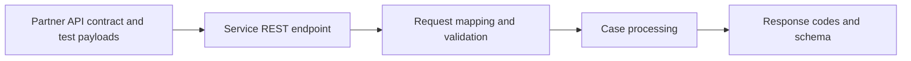

# Service REST Contract Tests: Protecting Consumers While Case Rules Evolve

**PFA-198** | Technical design study for Pega Senior and Lead System Architects | Laboratory verification pending

## Architecture problem

A partner sends customer onboarding requests to a Pega Service REST endpoint. After an application refactor, one optional field becomes mandatory and the partner sees hundreds of HTTP 400 failures. The internal PegaUnit suite passes because it tests the case flow, not the external request contract.

## System design

This diagram records a proposed boundary, not a fabricated Pega runtime screenshot. The interfaces and exact rule forms must be verified in a permitted sandbox.

## Feature inventory and design responsibilities

| Pega rule or component | Review requirement |
|---|---|
| Service REST rule and Service Package | Primary configuration and ownership boundary |
| Request Data Transform | Explicit input/output and identity contract |
| Validation rules | Apply platform-version-specific controls |
| Consumer contract fixtures | Test failure handling and observability |
| Integration test harness | Validate runtime access and support procedure |

## Implementation approach

1. Publish an explicit request and response contract, including required fields, nullable values, enumeration policy and error schema.

2. Test using a client identity with the real API access group, not the logged-in developer's context.

3. Provide fixture cases for valid, invalid, duplicate, unauthorized and unexpected-but-compatible payloads.

4. Version endpoint contracts deliberately when changing field meaning. Additive fields can still be breaking if unexpectedly mandatory.

5. Decouple transport acceptance from async business completion; return an operation ID and status semantics when work continues.

6. Run contract tests before promoting any ruleset that changes data transforms, service package security or validation.

7. Capture request correlation and redact customer data in recorded evidence.

## Design alternatives

| Option | Architectural trade-off |
|---|---|
| Only case-rule unit testing | Does not guarantee partner compatibility |
| Consumer contract + PegaUnit + integrated replay | Covers boundary and business rule |
| Version every tiny change with new API | High overhead, avoidable for truly backwards-compatible additions |

Choose the option that satisfies the business consistency contract and operational constraints. Avoid proving only the success path while deferring security, stale state and recovery behaviour.

## Failure modes and troubleshooting

Null versus absent field may select a different validation path. A harmless-looking data model change can alter response serialization. External clients may retry after a timeout and create duplicate cases if the service lacks idempotency.

Capture a sanitized case ID or operation identifier, relevant runtime node, application/ruleset version and timestamps. Correlate the origin and outcome across Pega and partner systems instead of relying on a single status message.

## Verification experiments

| Scenario | Evidence required |
|---|---|
| Experiment 1 | Replay last release's valid request set against candidate build. |
| Experiment 2 | Send unknown optional field and verify contract's compatibility rule. |
| Experiment 3 | Attempt unauthorized tenant case creation and verify denial. |
| Experiment 4 | Send duplicate operation ID after response loss; single case outcome. |

These are experiments to perform in a Pega lab. The article does not claim that any test has passed. A lab-verified version should include actual configuration screenshots, observed results and target Pega version.

## Production acceptance

Before deployment, the implementation needs documented data ownership, access context, expected peak volume, case compatibility, timeouts and retry boundaries, monitoring, escalation owner and a tested operational repair path. If the design changes a data model or class structure, verify legacy case paths and queued work.

## Pega technical source

- [Primary Pega reference](https://academy.pega.com/topic/authentication/v6)

Independent original technical analysis. Pega version-specific features and terminology must be confirmed against the target release; the scenario is fictional.
