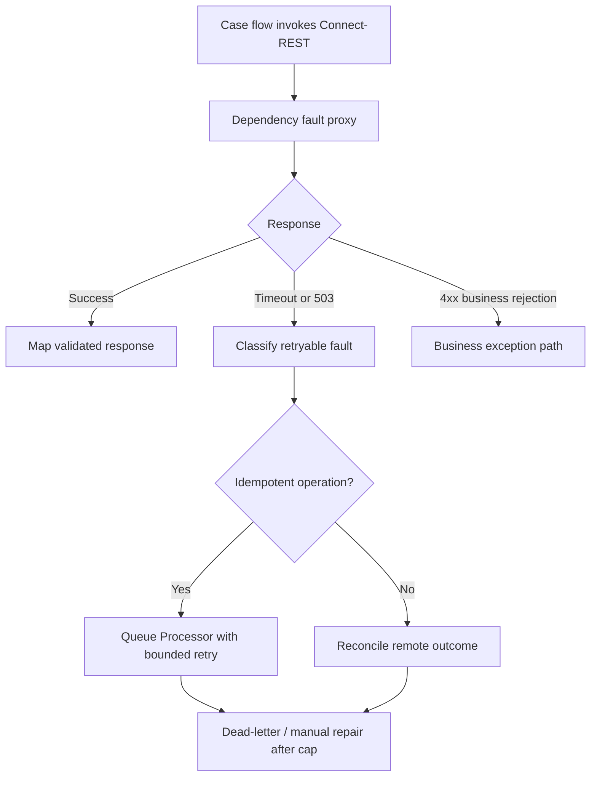

# Failure injection for unavailable downstream APIs

**Scope:** Pega enterprise architecture and LSA implementation guidance. Version-dependent configuration and recovery semantics require verification against the target platform release.

## A timeout that caused two payments

A benefits agency's Pega case submits a disbursement through a Connect-REST rule. The remote payment gateway accepts the request, but the network drops the response. The flow interprets the timeout as a failed payment and retries immediately. Two disbursements are issued. In another failure, a 503 from the gateway leaves the case locked while a synchronous activity loops through retries, degrading the operator experience.

A realistic test must distinguish a request that never arrived from one that completed remotely but whose acknowledgement was lost. An HTTP timeout does not establish that the downstream operation failed. Design both the integration contract and the failure-injection harness around uncertain outcomes.

## Boundary and error taxonomy

Define an integration contract containing a stable business operation ID, request schema, timeout budget, authentication profile, response mapping and idempotency behaviour. For payment submission, generate the operation ID before the first attempt and reuse it across all retries. The downstream system should deduplicate that ID and return the existing result, or expose a status query that allows reconciliation. Without either capability, automatic retries of a non-idempotent POST are unsafe.

Classify outcomes into transport failure, retryable service rejection, permanent validation failure, authentication/authorization failure and ambiguous completion. Configure Connect-REST response handling and Data Transforms so these categories become explicit case outcomes. Do not allow a generic exception path to silently advance the case as if payment were confirmed. Map status and error codes to a typed integration result rather than scraping free-text messages.

## Fault-injection architecture

Use a test-only gateway or proxy between Pega and the dependency. It must be able to return a deterministic 503, delay beyond the connector timeout, close the connection after forwarding the request, return malformed JSON and replay a duplicate success. Never use fault injection against real payment or customer endpoints. Capture correlation ID, operation ID, attempt count, request outcome at the stub and case state. Mask secrets and personal fields.

For asynchronous execution, prefer a Queue Processor or equivalent supported background mechanism to a tight activity retry loop. Define retry delay, maximum attempts, operational alerts and terminal handling. Queue processing does not remove the need for idempotency: an item may be retried after a crash or replayed by an operator.

## Implementation sequence

1. Document the case stage where the external call occurs and what business commitment follows it. Split request submission from confirmed completion when the external side effect is significant.
2. Build a contract stub with a durable ledger keyed by operation ID. Add modes for success, 400, 401, 429, 503, connection reset, slow response and accepted-but-unacknowledged.
3. Route a non-production Connect-REST endpoint to the stub through an approved environment configuration. Confirm TLS, authentication and endpoint promotion remain separately controlled.
4. Create Data Transforms that map both successful and error responses to an explicit integration-result data object. Reject incomplete success payloads.
5. Implement a retryable queue path with bounded attempts and jitter where supported by the chosen Pega version and infrastructure. Keep the same operation ID for each attempt.
6. For ambiguous completion, call a read-only status endpoint or route to a reconciliation assignment. Do not issue a second payment merely because the first response is missing.
7. Inject faults during the connector call, after remote commit, during queue item acknowledgement and during case save. Validate that Pega and the remote ledger converge.
8. Set a recovery runbook: locate the case, operation ID, last confirmed status and remote record; decide replay versus manual correction; record who approved it.
9. Repeat under concurrent load. Include operator refresh, duplicate clicks and queue restart to expose duplicate submission paths outside the connector itself.

## Tradeoffs

Synchronous calls give immediate feedback but hold the user's request open and couple availability to the dependency. Asynchronous calls improve resilience but require a visible pending state and a reconciliation mechanism. A long timeout may reduce retries while worsening response time and thread occupancy. Short timeouts are not automatically safer when the remote system commits after the client has given up. Exactly-once delivery should not be assumed from queues or HTTP; seek an effectively-once business outcome through stable IDs, deduplication and reconciliation.

## Production failure mechanics

After a deployment, a new error mapping may misclassify a 401 as retryable and flood the queue. Monitor failures by category and dependency, not just total queue depth. If the dependency is down, cap retry pressure, preserve work items and avoid an unbounded manual resubmit campaign. A breaker or admission control layer can protect the dependency, but must not lose committed case intent. The operator should see a pending or recoverable state rather than a false success.

## Reproducible verification matrix

| Injected fault | Expected case behaviour | Evidence |
| --- | --- | --- |
| 503 before processing | Bounded retry; no duplicate business effect | Attempt history and stub ledger |
| Response lost after remote commit | Reconcile same operation ID | One ledger entry, case eventually confirmed |
| 400 validation error | No automatic retry | Business exception assignment |
| 401 invalid credential | Security alert and stopped retries | Auth failure classification |
| Slow response | Timeout within agreed budget | Connector and request timings |
| Duplicate queue delivery | Deduplicated outcome | One remote operation despite two deliveries |
| Worker restart | Pending intent recovered | Queue status and final case state |

This matrix is a reproducible plan, not a report of executed tests. Retry settings and Queue Processor recovery semantics must be checked for the installed platform version.

## Primary reference

- [Pega: Commit method and transactional effects](https://docs.pega.com/bundle/platform-88/page/platform/reference/methods/commit.html)

## Architecture flow

## Evidence required before production approval

Attach a reviewed architecture decision, application and Pega release versions, rule identifiers, sanitized test evidence, observed results, open risks and rollback criteria. The matrix is a design-backed verification plan rather than a claim of completed laboratory testing.
