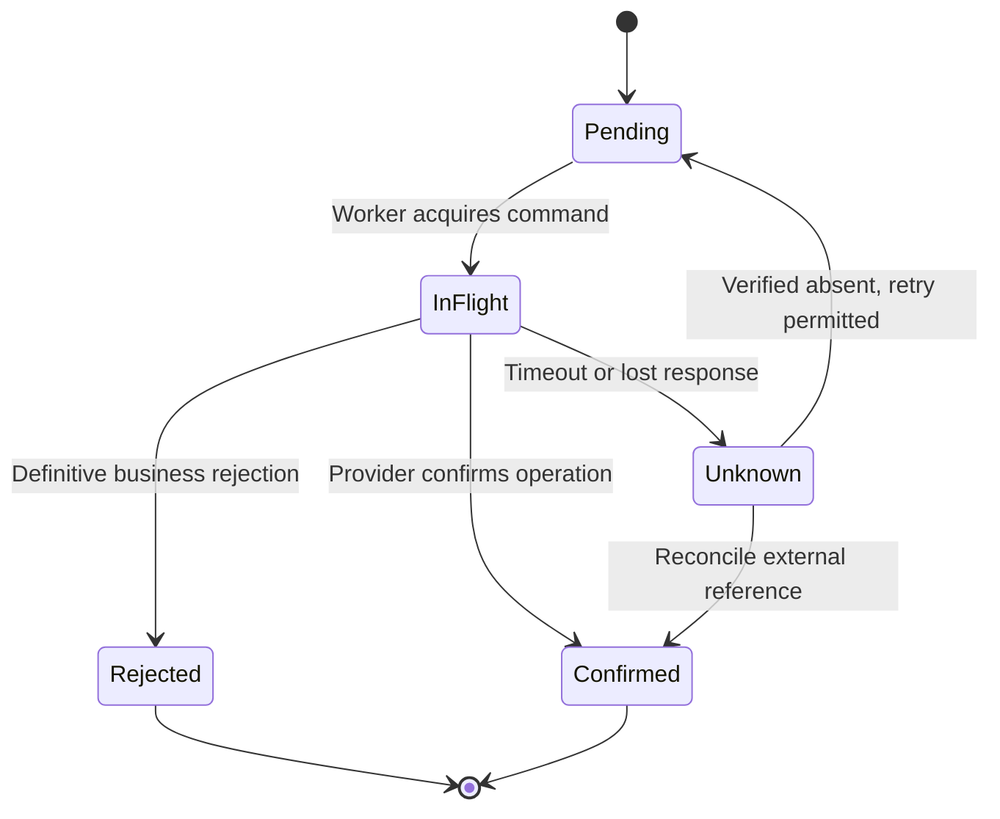

# Testing retry and duplicate message processing

**Audience:** Pega Lead System Architects and platform engineers. Design guidance is not a claim of laboratory validation.

A motor insurer's claims payment integration uses a Queue Processor to call a payment provider. During a maintenance window, the provider commits a transfer but its response is lost. Pega records a timeout, retries the queue item and creates a second transfer. The original unit test verified that the processing activity returns success when the provider returns 200. It never tested the ambiguous interval between an external side effect and a local commit.

A robust test suite treats at-least-once delivery, duplicate requests and partial failure as normal conditions. Exactly-once business effects are an application protocol, not a promise made by a queue.

## Specify the idempotency contract

Define a stable BusinessOperationID generated before the asynchronous handoff. Use that identifier as an idempotency key with the external system if its contract supports it. Maintain a Pega operation record with CaseKey, OperationType, BusinessOperationID, PayloadHash, ExternalReference, Status, LastAttempt and ReconciliationState. A repeated request with the same ID but a different payload must be rejected, not silently treated as a valid retry.

A Queue Processor activity should load this record, check whether the effect has already been confirmed, revalidate business prerequisites and invoke the external API only when needed. The system must distinguish permanent rejection, transient transport failure and ambiguous outcome. A timeout does not prove the provider rejected the request.

## Pega implementation design

1. Create a dedicated Data- class for the operation ledger, with a uniqueness constraint for BusinessOperationID and an explicit status model. Do not use a transient clipboard property as the deduplication store.
2. Validate the originating case and business action in the flow. Persist the operation intent using the platform's supported transaction boundaries, then enqueue the operation identifier.
3. Implement a processing activity that reads the ledger and case, checks current state and constructs the outbound Connect REST request from controlled data pages or a data transform.
4. Include the idempotency key in the partner request only when the partner's documented API supports it. Otherwise negotiate a lookup-by-reference reconciliation contract or an operational compensating procedure.
5. Use a bounded retry policy for transient transport errors and 429/5xx outcomes where retry is permitted. Do not retry a known business rejection or malformed payload.
6. For an ambiguous outcome, query the partner's status endpoint or reconcile its settlement feed before resubmitting. A retry storm must not become a payment storm.
7. Expose operation status in a case data page and case history summary. Do not mark the case paid until the external result is confirmed by the agreed business definition.
8. Record attempts and final resolution using opaque identifiers. Protect customer and payment details from test logs and diagnostic events.

## Failure injection harness

Use a deterministic mock provider with an operation ledger and a controllable fault switch. It must simulate: response lost after commit, rejection before commit, temporary unavailable, slow response, duplicate same-key request and same-key different-payload request. Exercise the Queue Processor with the real processing activity in a non-production Pega environment. PegaUnit tests can validate rule behavior, but a unit mock alone cannot establish persistence, restart and retry semantics.

Force worker termination at two points: after external success before Pega outcome persistence, and after Pega ledger update before the queue acknowledgement. Restart the worker and observe the resulting operation state. Include two concurrent workers competing for the same BusinessOperationID. Do not infer safety merely from a single-threaded test.

## Tradeoffs and production mechanics

A local deduplication table is simple but cannot prove whether an external call succeeded. A partner-supported idempotency key is stronger, yet the partner may expire its key retention before the Pega retry horizon. A distributed transaction across Pega and the provider is generally unavailable. A reconciliation protocol is therefore the reliable backstop.

If the queue message is malformed, moving it repeatedly to a retry state wastes capacity and hides a permanent defect. Quarantine it with a safe error classification and provide a controlled resubmission process after repair. When the same business operation is triggered from two case actions, the idempotency key must derive from business intent, not a fresh random value for each queue attempt.

## Reproducible verification matrix

| Fault injection | Execution | Expected result |
| --- | --- | --- |
| Lost response after commit | Provider records transfer then drops reply | Reconciliation finds one transfer |
| Duplicate delivery | Process same operation twice | One business effect and stable result |
| Parallel workers | Run same ID concurrently | Uniqueness and state guard prevent duplicate |
| Changed payload | Replay ID with altered amount | Conflict, no second transfer |
| Permanent rejection | Return validation error | No retry loop |
| Queue restart | Stop worker before acknowledgement | Recover without duplicate effect |
| Idempotency expiry | Advance mock partner retention window | Reconcile before any resubmission |
| Invalid case state | Cancel case while operation pending | Explicit policy enforced |

## Evidence standard

A passing suite includes partner ledger contents, Pega operation records, queue attempt history and case status for every scenario. Do not claim exactly-once execution; demonstrate at-most-one intended business effect under the tested failure model. Transaction and queue retry behavior depend on the Pega version and configuration.

**Primary reference:** [Pega Platform: Commit method and transaction guidance](https://docs.pega.com/bundle/platform-88/page/platform/reference/methods/commit.html).
