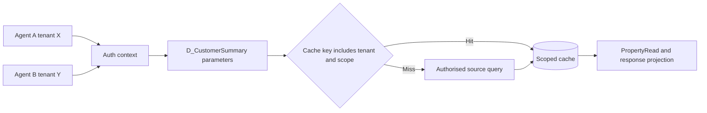

# Data Page Isolation Tests Across User Identities

## Enterprise failure scenario

A shared customer-summary data page returns the last agent's account notes when a second agent opens a different customer's case on the same node. The defect appears only after a warm cache and is missed by tests that always create a fresh requestor. A cache key omits tenant and entitlement context while a connector runs with a broad service identity. UI masking hides one field but the page still carries another customer's data.

## Architecture decision and Pega rule boundary

Classify each D_ data page by thread, requestor or node scope and identify every parameter that influences its response. A node-scoped page must never be parameterised solely by customer ID if tenant, region or entitlement affects the result. Enforce authorisation at the service and case boundary, not only at the view. Use Access Control Policy Read/PropertyRead where supported; design connector-level filters and response minimisation as separate safeguards. The cache key and access decision must use the same identity model.

## Implementation in order

1. Inventory D_ pages accessed by case views, Report Definitions, data transforms, REST services and queue workers. Capture scope, refresh policy, parameters and connector identity.

2. Classify which dimensions affect data visibility: tenant, business unit, operator role, region, legal entity and case ownership. Do not treat the current customer ID as a sufficient key.

3. Choose thread or requestor scope for identity-dependent content unless a proven safe node-level key partitions all security-relevant dimensions. Document expected memory cost.

4. Implement source-side filters using the effective authorised identity and tenant. Apply case Read and property PropertyRead policies so a forged API request cannot bypass the view.

5. Construct a deterministic test fixture with two tenants, overlapping customer identifiers, disjoint entitlements and a known shared customer visible to both under different masks.

6. Execute tests in both orders, A then B and B then A, on the same node and different nodes. Repeat after cache expiry, parameter omission and a role change.

7. Inspect the exact response shape, not just HTTP status. Verify forbidden values never appear in clipboard pages, JSON, search results or exported data.

## Failure mechanics in production

A node-scoped cache can outlive a requestor. A missing tenant parameter allows a cache hit generated under a privileged identity to be served to another user. A parameter that changes only the UI projection cannot repair a cache holding unrestricted data. Conversely, a requestor-scoped page may be secure but stale after an entitlement change; invalidation and reauthorisation remain necessary. Background processors running under service operators can unintentionally seed caches with broader visibility.

## Design tradeoffs

- Thread-scoped data minimises sharing but increases connector calls; node caching improves throughput only when partitioning is proven safe.
- Filtering at source reduces exposure and payload size but must be coordinated with Pega ABAC and changing entitlements.
- A test that always resets the requestor is deterministic yet misses warm-cache leakage; preserving cache state makes regression tests harder but more realistic.

## Reproducible verification matrix

Run these checks with synthetic data in a controlled test environment. Capture the application version, ruleset stack, requestor identity, test stimulus and expected persisted outcome. These are proposed checks, not executed results.

| Test and stimulus | Expected result and evidence |
| --- | --- |
| Tenant X then tenant Y, same node | Y never receives X-only attributes |
| Reverse identity order on warm cache | No order-dependent result |
| Two users share customer ID | Tenant partitioning prevents cross-read |
| Operator privilege revoked mid-session | Subsequent sensitive access reauthorised |
| Missing tenant parameter | Request fails closed, not global cache hit |
| Background job seeds cache | Interactive users see only authorised projection |
| Cache expiry and node failover | Security outcome unchanged despite reload |

## Incident runbook

On suspected leakage, isolate the affected data page, disable unsafe caching where operationally possible, and assess whether any shared response was delivered. Preserve access logs and parameter metadata without collecting additional personal data. Fix source authorisation and cache-key design before reopening service; merely flushing cache treats a symptom.

## LSA release acceptance and limitations

Require an identity-by-tenant test matrix, exact D_ page definitions, cache refresh configuration, connector authentication profile and evidence from warm-cache tests. The Pega Platform version matters because data page and security controls differ; confirm supported behaviour in the deployed release.

The architecture is design-backed and laboratory verification remains pending. A technical reviewer should inspect rule resolution, authorisation, Pega guardrail warnings, negative-path behaviour and rollback feasibility before promoting it. Capture controlled Tracer or PDC evidence only where available, and exclude sensitive clipboard content from shared logs. Do not interpret a diagram as evidence that the implementation has been tested.

## Verified Pega primary references

- [Pega access control policies](https://docs.pega.com/bundle/platform-23/page/platform/security/create-access-control-policy.html)
- [Pega authentication and session management](https://docs.pega.com/bundle/platform-241/page/platform/security/authentication.html)
