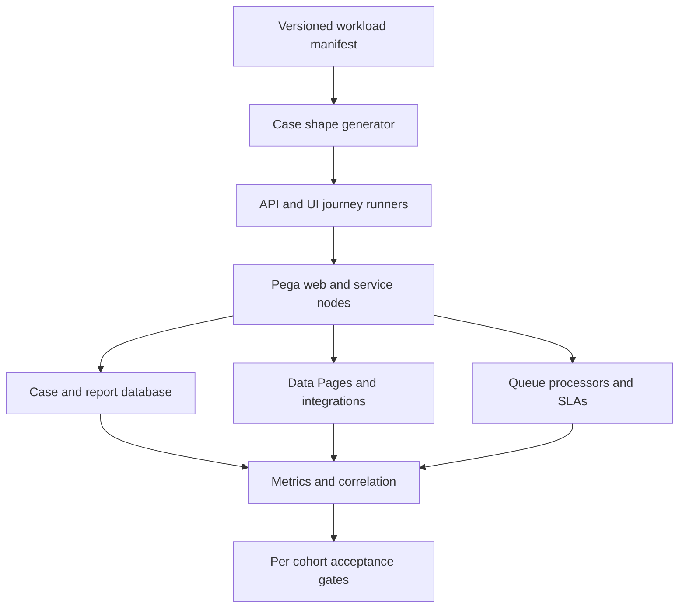

# Load tests with diverse real-world case shapes

## Failure scenario: a passing load test that predicts the wrong release

A bank's Pega onboarding platform handles simple individual applications, joint accounts, corporate ownership trees and exception reviews. A load test creates ten thousand identical simple cases and repeatedly opens their first assignment. Median response time looks healthy, but production slows sharply when complex corporate cases trigger large Page Lists, multiple Data Page loads, sanctions checks and long-running approval flows. The test measured the easiest path, not the system's real work.

A representative workload must preserve **case shape, lifecycle stage, concurrency and dependency behavior**. Transaction count alone is not a capacity model. An LSA should treat the load model as a versioned architecture artifact that business operations can audit and reproduce.

## Workload taxonomy

Define case cohorts from production-approved, anonymized aggregate observations rather than copying customer records. For example: simple retail cases with one party, joint cases with two applicants, corporate cases with nested beneficial-owner Page Lists, remediation cases with multiple attachments, and exception cases with SLA escalations. Record distributions of case age, assignment type, status, attachment count and external service calls. Do not publish synthetic percentages as observed production facts.

Pega objects to include: Case Type stages and flows, `pyWorkPage` data structure, `D_Customer` and `D_SanctionsResult` Data Pages, `Report Definition` worklist queries, `Connect REST` integrations, Queue Processor follow-up work, and the Access Groups that determine rule resolution. Include Constellation/DX API rendering where the application uses it. A UI-only script cannot represent asynchronous backlog or database contention.

## Test architecture

## Step-by-step implementation

1. **Create a case-shape manifest.** For each cohort, specify initial state, number of parties, Page List depth, attachment size band, expected integrations, active assignments, access group and expected background work. Store generators and seeds in version control.
2. **Separate creation from interaction.** Run a preparation phase that creates cases in the required stages, then execute journeys for open, save, submit, search and assignment routing. Otherwise the test measures case creation rather than steady-state service behavior.
3. **Model realistic concurrency.** Include users who think between actions, background jobs that continue independently, and peak bursts of case updates. Use arrival rates and concurrency windows rather than only a constant virtual-user count.
4. **Control external services.** Prefer isolated test doubles with documented latency and error profiles for load experiments. Then run a smaller contract test against real lower-environment services. Do not overload a shared enterprise endpoint without approval.
5. **Instrument the full path.** Capture per-cohort response-time percentiles, PAL and PDC indicators, database query timings, JVM memory, GC pauses, queue age, connector calls, cache miss rate and error classifications. Use a non-sensitive correlation ID.
6. **Exercise state transitions.** Include case lock conflicts, parallel approval completion, SLA events, retryable connector failures and a resumed case after a new deployment. These paths create different contention and persistence patterns from the initial assignment.
7. **Establish a baseline and regression gate.** Compare like-for-like hardware, Pega version, rule stack, database size and workload seed. A release passes only when both interactive and background service-level objectives remain inside agreed bounds.
8. **Preserve evidence.** Keep the test manifest, anonymization method, application artifact, environment details, scripts, raw results, PDC/PAL snapshots and analysis. A chart without these inputs cannot be reproduced.

## Failure mechanics and design decisions

A complex case often loads nested Page Lists and creates repeated Data Page requests in a single view. A worklist Report Definition may scan more rows when cases have many assignments. A queue processor can appear healthy during a UI test yet accumulate work when bulk submissions begin. Node-level cache warming can make later iterations fast while the first wave is slow. These are distinct bottlenecks, and each needs a corresponding measurement.

Generating all test data at once may distort indexes, cache state and database growth. Reusing the same case for every virtual user can create artificial lock contention; conversely, using only unique cases misses real-world contention on shared work. Include both patterns with known proportions. PegaUnit validates rule-level behavior but does not replace an end-to-end capacity test.

## Architecture tradeoffs

A fully production-like environment gives stronger performance evidence but costs more and may be impossible for confidential data. Synthetic test doubles improve repeatability but hide real downstream latency. A smaller test that covers all critical shapes may be more informative than a huge test of one path. Prefer representative cohorts, explicit limits and a documented uncertainty statement over an impressive single throughput number.

## Reproducible verification matrix

| Cohort or disturbance | Test action | Pass condition |
| --- | --- | --- |
| Simple retail | Open and submit standard case | Interactive latency within agreed cohort SLO |
| Corporate ownership tree | Open deep Page Lists and save | No uncontrolled clipboard or connector growth |
| Shared case | Two operators update assignment | Expected lock conflict, no lost update |
| Bulk creation | Burst create and queue follow-up | Queue age drains within agreed recovery window |
| Cold cache | Expire reference Data Pages | Tail latency separately reported |
| Large attachment | Upload within approved test limit | Resource budget respected; errors explicit |
| External 503 | Inject service outage | Bounded retries and visible business state |
| Release comparison | Replay same manifest and seed | Regression analysis isolates application changes |

**Verification status:** No load tests were executed for this article. Numbers and thresholds are intentionally left for a measured environment-specific baseline.

## Primary reference

- [Pega Infinity application development best practices, including PegaUnit, Data Page and exception-handling guidance](https://docs.pega.com/bundle/platform-242/page/platform/app-dev/best-practices-infinity-application-development.html).
