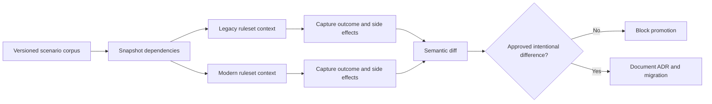

# Comparing old and new rules during modernization

## Failure: equivalent screens, different business outcomes
A utility provider replaces an activity-heavy tariff-change process with data transforms, decision tables and a simplified case flow. Happy-path acceptance tests pass. After release, a backdated tariff correction incorrectly applies a new eligibility rule to cases opened before the effective date. The old activity used a persisted tariff snapshot, while the new decision table reads today's reference data. The UI appears identical, but the business result and audit trail have changed.

## Define semantic equivalence before comparison
Rule comparison is not just comparing two `Rule-Obj-Activity` XML exports. Define observable contracts: case status, assignment routing, calculations, integrations, emitted events, audit history and expected errors. Compare the old and new implementations against a versioned set of inputs and a frozen dependency state. Use `Rule-Declare-DecisionTable`, `Rule-Obj-When`, `Rule-Obj-Model`/data transforms and flow rules as appropriate, while recording rule resolution context, ruleset stack, circumstances and effective dates. Two rules with the same name may resolve differently under different access groups.

## Engineering implementation
1. Inventory entry points, including UI actions, service endpoints, queue processors, SLAs and delegated decision rules. Capture all cases that may invoke the legacy path after deployment, not only newly created cases.
2. Create a **golden scenario corpus** from synthetic and sanitized cases: ordinary approvals, missing reference data, backdated corrections, boundary dates, withdrawn applications, partial failures and multiple regional circumstances. Record expected outcomes from business policy, not merely from the legacy implementation.
3. Freeze mutable dependencies. Stub `Connect-REST` results, reference-data pages and system time. If old code relies on `D_Tariff` with requestor cache while new code uses a live node cache, that difference must be explicit. Include rule resolution evidence from both applications.
4. Build automated rule tests where supported, plus a case-level harness that starts the same initial case state in isolated test environments. Do not execute both variants against the same live external system. Capture before/after clipboard properties and persisted records, but mask customer data.
5. Normalize only nondeterministic fields such as generated IDs and timestamps in the comparison. Never normalize amounts, status, privilege outcomes or external event count. Use an explicit allowlist for intentional differences.
6. Classify each discrepancy: required policy change, legacy defect fixed intentionally, regression, or inconclusive due to missing fixture. Require business sign-off for policy changes and technical evidence for fixes.
7. Run migration tests on **open** cases paused in old flow shapes. The current ruleset stack can resolve a changed flow while assignments still refer to previous shapes. Include resume, SLA expiry and worklist routing.
8. Use a controlled cohort or shadow evaluation for low-risk read-only decisions. For write operations, compare in isolated sandboxes or use side-effect-free decision functions; never double-submit a payment or notification.

## Tradeoffs and production diagnosis
Keeping the old path available reduces migration risk but doubles support burden and may expose stale rules to new cases. A shared facade that selects old or new logic by case version is safer than implicit rule resolution, provided the selection rule itself is tested. Byte-for-byte clipboard equality is usually too strict; UI-only comparison is too weak. Semantic contracts strike the balance but require domain-specific assertions.

A regression may surface only when a node has a warmed data page or a background requestor with a different access group. Test both warm and cold execution. A failed comparison must show the input fixture, resolved rule versions, dependency responses and exact business field difference. Without these, a team may wrongly classify a real defect as a test flake.

## Verification matrix
| Test | Fixture | Expected result | Artifact |
|---|---|---|---|
| Ordinary approval | Standard synthetic tariff | Same eligibility and amount | Normalized diff |
| Backdated case | Old effective date | Historical policy honored | Rule and date trace |
| Regional override | Region-specific access group | Correct circumstance resolved | Rule resolution log |
| Missing dependency | 404 from tariff API | Same documented exception path | Case status |
| Duplicate retry | Replayed external callback | Exactly one side effect | Event ledger |
| Open case migration | Old assignment paused | Resume without stranded assignment | Flow audit |
| Security denial | Restricted operator | No privilege escalation | Access test |
| Intentional change | Approved new policy | Difference linked to decision record | Signed ADR |

No passing test results are asserted. This matrix is a reproducible release gate to execute against the target Pega version.

## Verified Pega references
- [Organizing rules into rulesets, Platform '24.2](https://docs.pega.com/bundle/platform-242/page/platform/app-dev/organizing-rules-into-rulesets.html)
- [Pega Infinity application development best practices, Platform '24.2](https://docs.pega.com/bundle/platform-242/page/platform/app-dev/best-practices-infinity-application-development.html)
