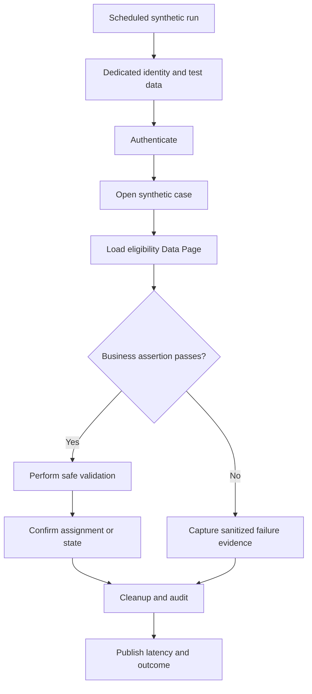

# Synthetic production monitoring of high-value journeys
## Failure scenario
A national benefits service reports healthy infrastructure and successful login probes, but citizens cannot complete a renewal. The case opens correctly; a mandatory eligibility Data Page loads from a third-party service, and its error branch displays an empty list. The synthetic monitor checks only the landing page, so the incident is first discovered through calls to the service desk. A second monitoring bot creates real applications and pollutes operational queues. Monitoring must validate the business outcome while remaining non-destructive.

## Design the journey contract
Select journeys by business criticality and operational risk: authenticate, find an existing case, load required data, complete a validation step, and observe a terminal response or assignment. Define each journey as a sequence of observable contracts, not brittle CSS coordinates. For a Constellation application, favor stable semantic UI contracts and supported APIs where possible. Traditional UI and Constellation render differently; confirm selectors and DX API capabilities for the deployed version.

Use dedicated synthetic operators with narrowly scoped Access Groups, privileges and synthetic customer records. Test identities must not bypass authorization controls merely to make monitoring reliable. Ensure the service account cannot view real case data. Maintain a separate synthetic case prefix, retention policy and cleanup process. Use case type, Stage, Step, Flow Action, Data Page and Service REST boundaries as observability checkpoints. Avoid relying only on HTTP 200: a successful page response may contain an error view or a failed connector result.

## Engineering implementation
1. Map three high-value journeys to business outcomes. For renewal, assert that the correct case type opens, the expected Stage and Step appear, the eligibility field is populated from a controlled fixture, and the intended assignment is created. Avoid assertions based on incidental wording.
2. Provision synthetic data in a designated tenant or approved production test segment. Use reversible, idempotent operations and never submit a real payment, notification or external entitlement change. If a journey has irreversible side effects, test its read-only boundary and validate the full flow in a non-production environment.
3. Configure a dedicated operator and Access Group. Test the same authorization path as the intended user role without granting administrator privileges. Rotate credentials through the enterprise secret manager and prohibit credentials in monitor logs.
4. Instrument each step with a correlation ID carried through HTTP requests, Pega case identifiers and connector calls where supported. Record transaction type, duration, outcome and target environment. Hash or redact identifiers before exporting to telemetry.
5. Use Pega case status and assignment state to assert progress. If using Service REST or DX API, verify supported endpoints and authentication for the release. A browser test should detect inaccessible buttons and error messages; an API test should detect contract failures.
6. Introduce a second monitor for background completion where Queue Processors or SLAs drive the result. The first monitor should not mark the journey successful before asynchronous work completes.
7. Add rate limits and execution windows. Monitoring should not compete with customer traffic or trigger alert storms during planned maintenance. Separate authentication failures from business-rule failures and third-party dependency outages.
8. Capture sanitized screenshots only when approved, along with response codes, correlation IDs and rule version metadata. Never save real customer screens or full clipboard dumps in a monitoring vendor.
9. Build cleanup reconciliation: query synthetic cases older than the allowed window, confirm external side effects are absent, and route cleanup failures to a monitored work queue.

## Failure mechanics and tradeoffs
Browser monitoring catches rendering and interaction failures but is sensitive to UI change; API monitoring is more stable but can miss a broken user journey. Running both gives stronger evidence at higher maintenance cost. A synthetic fixture can become stale when business rules change, causing false alarms; version fixtures alongside the case application. Conversely, auto-updating fixtures to match any new output may hide a regression.

Synthetic operators can unintentionally bypass MFA, routing and access restrictions if their permissions differ from real users. Document what the monitor does and does not prove. A green journey at one node does not guarantee regional or tenant coverage; distribute probes deliberately.

## Verification matrix
| Fault injection | Setup | Required result | Evidence |
|---|---|---|---|
| Connector unavailable | Return controlled 503 | Journey fails at eligibility | Step trace |
| UI broken | Hide required action in test | Browser probe detects failure | Sanitized screenshot |
| Authorization removed | Revoke test role | Explicit access failure | Security log |
| Queue delay | Hold synthetic background item | Monitor waits then alerts | Queue correlation |
| Duplicate run | Trigger same run ID twice | No duplicate real side effect | Case audit |
| Fixture drift | Change expected rule output | Version mismatch identified | Fixture commit |
| Cleanup failure | Deny cleanup operation | Separate actionable alert | Work queue item |

This is a reproducible design specification, not evidence of a production monitor or completed test.
## Verified primary guidance
- [Creating a Data Page, Pega Platform '25](https://docs.pega.com/bundle/platform-25/page/platform/data-integration/creating-data-page.html?workflow=creating-data-pages)
