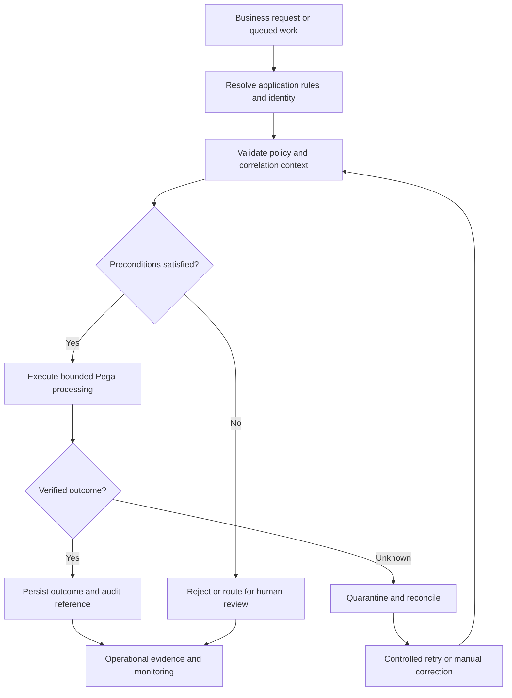

# Validating long-running flow resumptions after release

## Enterprise incident and architectural boundary

An insurance case pauses at an assignment for several months. After a flow rule changes, the user resumes the old assignment and encounters a missing connector or a new required property that was never populated in the persisted case. This is a design scenario, not a claim about a measured production incident. The central architecture question is which component owns the control, how failure is observed, and how the team proves that the control survives an upgrade and an operational incident. A successful happy-path demonstration is insufficient because the damaging behavior often appears on retry, restart, migration, or operator handoff.

## Pega implementation surface

Relevant Pega objects and runtime surfaces include Flow rules, assignments, work objects, flow versions, data transforms, SLA processing and case type stages. The implementation team must inspect actual rule resolution in the deployed application stack rather than assume that the latest edited rule is the runtime rule. Access groups, application rules, class inheritance and ruleset availability can change the effective behavior. Where a named capability differs by Pega Platform or product release, validate it against the target version before choosing a rule form or configuration field.

## Design decision

Inventory open cases by persisted flow state before release. Preserve compatibility paths for old assignments, and migrate state only through a rehearsed and reversible procedure with per-case audit. Keep the control at the narrowest stable boundary that covers interactive requests and asynchronous execution. Separate business policy from infrastructure failure handling so that a timeout, a retry, or a delayed message cannot silently change the business outcome. Record the owning team, escalation path, configuration location and safe rollback trigger in the architecture decision record.

## Technical flow

The diagram is a logical control flow, not an assertion that every release provides a built-in circuit breaker, correlation propagation or quarantine queue. Implement missing controls in the application integration layer and test their behavior. The verified outcome is a business fact, not merely a successful HTTP response or an Activity step returning without an exception.

## Step-by-step architecture and implementation

1. **Baseline the deployed application.** Capture application version, ruleset stack, rule keys, access group, relevant class mappings, node topology and dependency endpoints. Record the current business behavior using synthetic data and a repeatable case identifier. Distinguish configuration owned by Pega from configuration owned by the connected system.
2. **Map the failure path.** Extract a representative cohort of paused cases; snapshot status and assignment keys; deploy into a production-like environment; resume from each historical shape; test SLA escalation and cancellation; reconcile completed work and assignment counts. Break the sequence into entry, authorization, processing, persistence, downstream acknowledgement and operational recovery. For every transition identify the unique correlation token and the system that owns authoritative state.
3. **Implement the guardrail.** Configure the appropriate Pega rule or integration wrapper so invalid state cannot enter the expensive or irreversible path. Keep validation separate from presentation. Avoid copying entire clipboard pages into log messages or external payloads when only a few properties are required.
4. **Handle retries explicitly.** Choose an idempotency key based on the business operation, not the requestor session. Define which failures are retryable, the maximum retry window and the reconciliation path for unknown completion. An asynchronous retry must not create a second case outcome or overwrite a newer approved value.
5. **Instrument with privacy controls.** Emit event type, case reference token, rule version, attempt number, elapsed duration and result class. Restrict access to diagnostics, use an appropriate retention policy and redact customer values before they leave the requestor context.
6. **Deploy through a controlled release.** Package dependent rules and data with explicit version requirements. Rehearse the rollback while representative open cases and queued work exist. If reverting a rule cannot safely undo persisted changes, use a forward-fix or compatibility adapter instead of an unconditional rollback.
7. **Transfer to operations.** Provide a runbook with symptoms, dashboards, evidence queries, safe pause/resume instructions, decision owner and escalation criteria. The runbook must identify when human intervention is required and how to prevent repeat processing.

## Tradeoffs and rejected alternatives

Keeping legacy flows extends maintenance cost; forced migration simplifies code but risks breaking in-flight work. A dual-version compatibility window reduces cutover risk. The chosen design should optimize for predictable failure, recoverability and auditability, not only average throughput. A lower implementation cost is not sufficient justification if an operator cannot distinguish completed, failed and unknown outcomes. A more centralized control may improve consistency but increase blast radius; decentralized controls require contract tests to prevent drift. Document the alternative, its cost and the condition that would justify revisiting it.

## How production failure actually develops

A renamed flow action is absent from the version resolved on resume. A background SLA action races with an operator and creates duplicate downstream work. The incident can be amplified by a second node, a stale data page, a retry after timeout, or a new ruleset version resolving for a resumed assignment. Treat an acknowledgement as evidence only for the operation it actually confirms. Monitor both technical symptoms and business invariants, because a green infrastructure dashboard can coexist with an incorrect case state. Preserve enough immutable identifiers to reconstruct the event chain without retaining unnecessary personal information.

## Reproducible verification matrix

| Test | Setup and action | Required evidence |
|---|---|---|
| V1 | Old assignment resumes successfully using synthetic test cases and a controlled fault or configuration change | Case audit, rule version, correlated logs and before/after state; record actual observed result in lab |
| V2 | SLA event resumes once using synthetic test cases and a controlled fault or configuration change | Case audit, rule version, correlated logs and before/after state; record actual observed result in lab |
| V3 | Cancelled case cannot re-open using synthetic test cases and a controlled fault or configuration change | Case audit, rule version, correlated logs and before/after state; record actual observed result in lab |
| V4 | Failed migration restores previous state using synthetic test cases and a controlled fault or configuration change | Case audit, rule version, correlated logs and before/after state; record actual observed result in lab |
| V5 | Deploy a compatible rule change while an old case or queued item is pending | No duplicate or lost business outcome; explicit reconciliation record if uncertain |
| V6 | Revoke relevant operator or service permissions during the workflow | Denied operation with no unauthorized state change and no sensitive diagnostic leak |

**Evidence status:** These are acceptance tests to execute, not test results. No latency, success rate, screenshot or security certification is claimed. Capture environment version, exact configuration, test input, timestamp and observed outcome before changing verification status.

## Architecture review checklist

The LSA review should confirm that business ownership is explicit, rule resolution is understood, asynchronous paths have equivalent controls, failure can be safely replayed, and observability does not introduce a new privacy or availability risk. Confirm the decision is compatible with the target Pega Platform release and product licenses. Prefer supported Pega configuration and documented extension points over private runtime internals. Where the platform does not expose a required hook, identify an integration boundary rather than assuming undocumented behavior.

## Operational exit criteria

Release approval requires an identified owner for the business invariant, an executable negative-path test, a monitored error budget, and a rollback or forward-recovery plan that has been rehearsed with non-production data. A production incident must be recoverable from case history and correlation records without manual database edits. Review these criteria after every significant application upgrade or dependency change.
