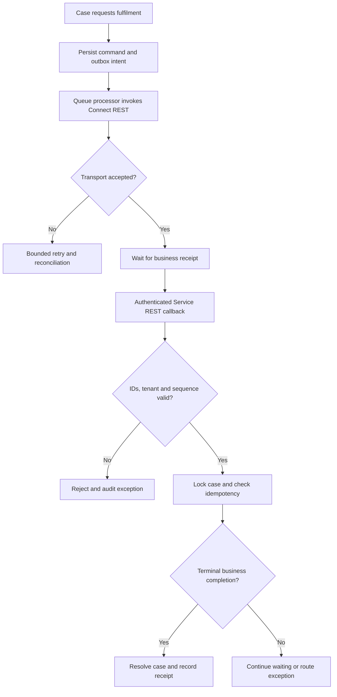

# Cross-system work completion acknowledgement

## Failure scenario

A Pega service case issues a fulfilment command to an external workforce platform. The connector receives HTTP 202 and advances the case to Resolved-Completed. The external system has merely queued the job. Hours later it fails because a supplier record is inactive. The customer receives a completion notification despite no work having occurred. A duplicate callback then creates a second fulfilment assignment. This is a business contract defect, not a transport outage.

The design invariant is that a transport acknowledgement cannot authorize a business-complete case transition. The LSA must define who owns the terminal status and what evidence makes it trustworthy. These are proposed controls, not results from a Pega lab.

## Data and rules

Create a Data-WorkReceipt class with properties for case ID, command ID, external work ID, tenant, event sequence, event timestamp, acknowledgement type, business outcome, signature verification status and correlation ID. Use a parameterized D_ExternalWorkStatus data page to read the external authoritative state. Validate its scope and refresh policy against the installed release.

| Rule | Purpose |
|---|---|
| Case Type and Wait shape | Keep case in fulfilment-pending until verified receipt |
| Connect REST | Submit idempotent command and classify transport response |
| Service REST | Authenticate callbacks and normalize receipt contract |
| Data Transform | Map external status into guarded case properties |
| Validate rule | Reject missing IDs and illegal state transitions |
| Queue Processor | Retry dispatch and reconcile missing receipts |
| Report Definition | Find stale work and contradictory terminal states |
| Access role and policy | Restrict receipt and customer data by tenant |

A command identifier is generated before dispatch and must remain unchanged across retries. Persist dispatch intent and audit event before asynchronous work. An HTTP 200 or 202 is only an indication that the remote endpoint responded. Only a validated business receipt, correlated to the expected command and external work ID, can advance the milestone.

## Technical flow

## Implementation steps

1. Define requested, accepted, in-progress, completed, failed and cancelled as separate states, including allowed transitions and ownership.
2. Create the receipt data class, identifier properties and a unique business idempotency key. Decide which fields are sensitive and apply retention.
3. Persist command intent and original correlation ID before the asynchronous connector call. Do not generate a new command ID for a timeout retry.
4. Configure Connect REST mapping to distinguish transport errors, schema errors and valid acceptance responses.
5. Configure Service REST callback authentication, tenant validation and strict mapping to a versioned receipt schema.
6. Acquire the case lock, compare receipt sequence and check prior processed event IDs before applying a business transition.
7. Only advance a Wait shape or case milestone on a terminal authenticated business completion event. Route failure to an exception assignment.
8. Build a queue processor reconciliation operation to query D_ExternalWorkStatus when callbacks are delayed, lost or contradictory.
9. Provide support reports showing stale requests, duplicate receipts, failed work and pending reconciliation.
10. Test cutover behavior with in-flight commands when changing endpoint or ruleset version.

## Design decisions and tradeoffs

**Push versus polling:** callbacks reduce read traffic but require authentication, replay protection and observability. Polling is simpler when external events are unreliable but increases latency and dependency load. A hybrid model can use callbacks for normal operation and polling for stale requests.

**Synchronous versus asynchronous:** blocking a user thread until fulfilment is complete is inappropriate for long-running work. Persist an asynchronous command and expose pending status to users. Do not equate a successful connector invocation with a completed business task.

**Exactly-once expectations:** distributed delivery may be at least once. Deduplicate on business command ID and expected milestone, not merely on the HTTP request ID. A timeout can occur after a remote commit, so retries must query authoritative status or reuse an idempotency key.

**Audit versus privacy:** store evidence sufficient to explain the transition, including original command, receipt type and external reference, without copying unnecessary personal data into case history. Limit access to the receipt class and report definitions.

**Concurrent correction:** an operator may manually repair a failed task while a delayed completion callback arrives. Compare case version and terminal state under lock; do not let the callback erase an approved manual resolution.

## Production failure mechanics

A queue processor can retry a command after a network timeout even when the external platform already created the work item. Without a stable command ID, duplicate work occurs. Conversely a completion callback may arrive before the original acceptance event. A strict sequence contract should either buffer, reconcile or reject out-of-order events safely. A newly deployed mapping rule may interpret an old status code differently; version the contract and test replay across releases.

## Reproducible verification matrix

| Test | Setup | Expected result |
|---|---|---|
| Accepted only | External API returns 202 without completion | Case remains pending |
| Completed | Authenticated receipt matches command and work ID | Exactly one terminal transition |
| Duplicate callback | Send identical completion event twice | No duplicate assignment or notification |
| Wrong tenant | Signed-in service identity lacks tenant scope | No case mutation |
| Timeout after remote commit | Suppress connector response | Reconciliation finds existing work |
| Out-of-order event | Completion precedes acceptance | Safe terminal-state handling |
| Concurrent manual repair | Operator updates case before callback | No lost correction |
| Upgrade regression | Replay receipts against new ruleset | Contract compatibility or explicit rejection |

Record the case ID, command ID, ruleset version, redacted connector log, before and after case status, and audit record for each scenario. The table defines tests to execute; it does not assert they have passed.

## Operational acceptance

Require the external platform owner to document terminal-state semantics, callback authenticity, retry guarantees and reconciliation endpoint. Require the business owner to approve case closure criteria. Monitor stale pending work, failed business receipts and unmatched callbacks separately from HTTP availability. Use observed baselines to establish alerts, and maintain a supervised repair runbook.

Pega rule availability and queue processor behavior vary by platform release. Confirm implementation details against the installed version and run the verification matrix in a representative environment. Actual publication UTC is tracked separately from historical Git author dates.
